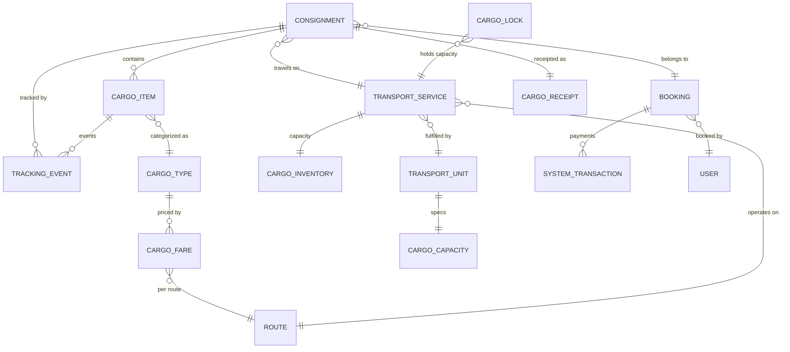
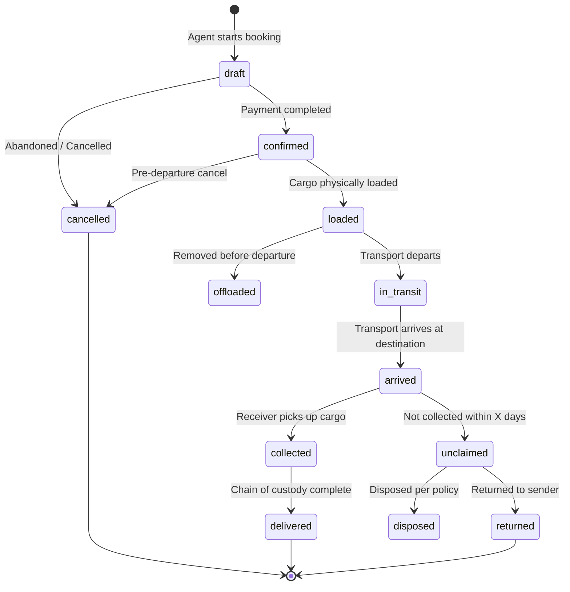
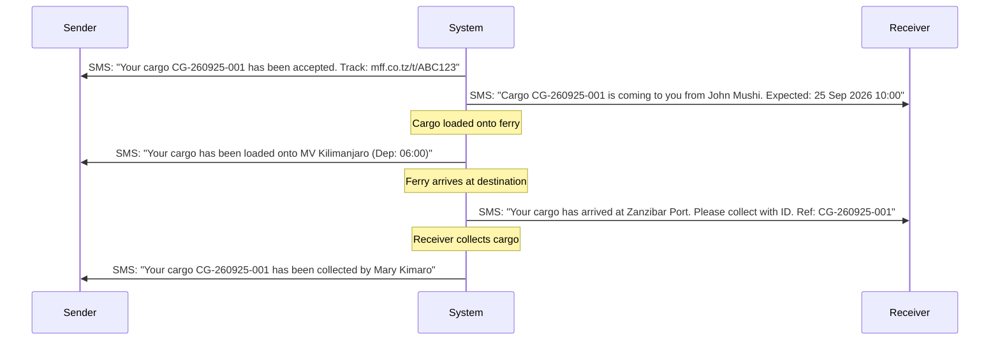

# UNIVERSAL CARGO & LOGISTICS PLATFORM (UCLP)
## Master Plan — Version 1.0

**Document Classification**: Strategic Architecture & Design Blueprint  
**Authored by**: Principal Systems Architect  
**Date**: September 2026  
**Status**: DRAFT — Pending Stakeholder Approval

---

## Table of Contents

1. [Executive Vision](#1-executive-vision)
2. [Industry Context & Problem Statement](#2-industry-context--problem-statement)
3. [Strategic Design Philosophy](#3-strategic-design-philosophy)
4. [System Architecture Overview](#4-system-architecture-overview)
5. [Domain Model & Bounded Contexts](#5-domain-model--bounded-contexts)
6. [Multi-Modal Transport Abstraction](#6-multi-modal-transport-abstraction)
7. [Cargo Lifecycle State Machine](#7-cargo-lifecycle-state-machine)
8. [Booking Engine Architecture](#8-booking-engine-architecture)
9. [Pricing & Tariff Engine](#9-pricing--tariff-engine)
10. [Tracking & Visibility Platform](#10-tracking--visibility-platform)
11. [Portal Architecture (Sales & Management)](#11-portal-architecture-sales--management)
12. [Capacity & Inventory Management](#12-capacity--inventory-management)
13. [Financial Architecture](#13-financial-architecture)
14. [Notification & Communication Engine](#14-notification--communication-engine)
15. [Security & Compliance Framework](#15-security--compliance-framework)
16. [Integration Architecture](#16-integration-architecture)
17. [Reporting & Analytics Platform](#17-reporting--analytics-platform)
18. [Technology Stack](#18-technology-stack)
19. [Implementation Roadmap](#19-implementation-roadmap)
20. [Risk Assessment & Mitigation](#20-risk-assessment--mitigation)

---

## 1. Executive Vision

### 1.1 The Big Picture

The Universal Cargo & Logistics Platform (UCLP) is a **transport-agnostic, multi-modal cargo management system** designed to handle the end-to-end lifecycle of parcels, freight, vehicles, and specialized cargo across **ferries, buses, trucks**, and any future transport modality (rail, air cargo, drones).

This is not a module bolted onto an existing passenger booking system — it is a **first-class logistics domain** that shares foundational infrastructure (authentication, payments, agents, routes) while operating with its own distinct workflows, capacity models, pricing engines, and operational procedures.

### 1.2 Core Value Proposition

| Stakeholder | Value Delivered |
|---|---|
| **Sender (Customer)** | Walk-in or call-ahead booking, real-time tracking via SMS/WhatsApp, proof-of-delivery, transparent pricing |
| **Sales Agent / Officer** | Unified POS interface for passenger + cargo, instant fare calculation, one-click receipt printing, commission tracking |
| **Operations Manager** | Real-time cargo deck utilization, loading manifests, weight compliance dashboards, cross-modal capacity planning |
| **Finance Team** | Unified revenue reporting across passenger + cargo, automatic reconciliation, agent float management for cargo transactions |
| **Executive Leadership** | Cargo revenue as a distinct P&L line, route profitability analysis, demand forecasting, fleet optimization data |

### 1.3 Design Tenets

1. **Transport-Agnostic Core** — The cargo domain model does not assume "ferry." Vehicles, parcels, and freight move between origin and destination on a `TransportUnit` which could be a ferry deck, a bus cargo hold, or a truck trailer.
2. **Sender-Receiver Separation** — Cargo always has a sender (who consigns at origin) and a receiver (who collects at destination). They may or may not be the same person.
3. **Pessimistic Capacity Locking** — No overbooking. Period. Capacity is locked atomically before data entry begins.
4. **Consignment-Centric, Not Ticket-Centric** — A cargo `Consignment` is not a passenger ticket. It has dimensions, weight, handling instructions, hazmat classification, and chain-of-custody tracking.
5. **Real-Time Visibility** — From the moment cargo is accepted at the counter to the moment it's collected at the destination, every state transition is logged and (optionally) pushed to sender/receiver.
6. **Extensibility by Design** — New transport types, cargo categories, pricing models, and tracking mechanisms can be added without schema migrations or core service refactoring.

---

## 2. Industry Context & Problem Statement

### 2.1 Current State (As-Is)

The existing booking platform handles **passengers only**. The domain model revolves around:
- **Bookings** → **Tickets** → **Passengers** on **Voyages** (Ferry departures)
- Seat-based inventory (SeatInventory per travel class per voyage)
- Payment via Cash, Mobile Money, Agent Float, Card
- Agent/Sales Portal (Vue SPA) for ticket sales

Cargo is handled **manually** — paper logbooks, handwritten receipts, no capacity tracking, no digital trail, no revenue attribution. This creates:

- **Revenue leakage** — Cargo income is not captured in digital financial records
- **Overbooking** — No system to track remaining deck/hold space
- **Zero traceability** — Lost cargo has no chain-of-custody trail
- **Manual pricing** — Agents negotiate ad-hoc, creating pricing inconsistency
- **Compliance risk** — No hazmat tracking, no weight compliance, no manifest integrity

### 2.2 Multi-Modal Reality

The business operates (or plans to operate) across multiple transport modes:

| Mode | Cargo Types | Capacity Model | Unique Characteristics |
|---|---|---|---|
| **Ferry (Ro-Pax)** | Vehicles, freight, parcels, electronics, livestock | Lane-meters + Weight + Volume (CBM) | Roll-on/Roll-off, deck assignments, IMO hazmat |
| **Bus** | Parcels, luggage, small freight | Weight + compartment slots | Under-floor cargo hold, limited weight per bus |
| **Truck** | Full-load freight, containerized cargo, furniture | Weight + Volume (CBM) | Door-to-door, multi-stop routes possible |
| **Future: Rail** | Bulk freight, containers | TEU (Twenty-foot Equivalent Unit) | Long-haul, scheduled departures |
| **Future: Air Cargo** | Express parcels, documents, perishables | Weight (chargeable weight = max of actual vs volumetric) | Speed premium, strict weight limits |

A system built for "ferry cargo" alone would need a complete rewrite when buses and trucks are added. The UCLP avoids this by abstracting the transport layer.

### 2.3 Target State (To-Be)

A fully integrated logistics platform where:

1. An agent at any counter can book cargo on **any available transport** (ferry, bus, truck)
2. The system automatically calculates capacity availability, pricing, and estimated delivery time
3. Sender and receiver receive real-time status updates via SMS
4. Every piece of cargo has a unique tracking number and QR code
5. Loading teams use mobile scanners to verify and record cargo movements
6. Management has a live dashboard showing cargo revenue, utilization, and performance across all transport modes
7. The cargo module integrates seamlessly with the existing passenger booking system — shared routes, agents, payments, and reporting

---

## 3. Strategic Design Philosophy

### 3.1 Domain-Driven Design (DDD) Approach

The cargo platform is modeled using DDD bounded contexts:

```
┌─────────────────────────────────────────────────────────────┐
│                     SHARED KERNEL                           │
│  (Routes, Ports/Stations, Agents, Users, Payments,         │
│   Currencies, System Config, Notifications)                 │
└────────┬───────────────┬────────────────┬───────────────────┘
         │               │                │
    ┌────▼────┐   ┌──────▼──────┐   ┌─────▼─────┐
    │PASSENGER│   │   CARGO     │   │ TRANSPORT  │
    │ CONTEXT │   │  CONTEXT    │   │  CONTEXT   │
    │         │   │             │   │            │
    │Bookings │   │Consignments │   │ Vessels    │
    │Tickets  │   │Cargo Items  │   │ Buses      │
    │Seats    │   │Tracking     │   │ Trucks     │
    │Boarding │   │Chain-of-    │   │ Schedules  │
    │         │   │Custody      │   │ Voyages    │
    └─────────┘   └─────────────┘   └────────────┘
```

### 3.2 The Transport Unit Abstraction

Instead of coupling to "Voyage" (ferry-specific), cargo is booked on a **Transport Service** — an abstract departure that can be fulfilled by any transport mode:

```
TransportService (Abstract Departure)
├── id, service_number (e.g., "FS-20260925-0600" or "BS-20260925-0800")
├── transport_type (ferry | bus | truck | rail)
├── transport_unit_id → links to Vessel, Bus, or Truck
├── route_id → shared routes table
├── departure_datetime
├── arrival_datetime (estimated)
├── status (scheduled | boarding | departed | arrived | cancelled)
└── capacity → CargoCapacity (polymorphic per transport type)
```

> **Phase 1 Implementation**: For the initial release, `TransportService` maps directly to the existing `Voyage` model for ferries. When buses/trucks are added, the abstraction layer enables them without touching cargo booking logic.

### 3.3 Key Architecture Patterns

| Pattern | Application |
|---|---|
| **Strategy Pattern** | Pricing engine — different calculators for flat, per-kg, per-CBM, dimensional weight |
| **State Machine** | Cargo lifecycle — `accepted → loaded → in_transit → arrived → collected → delivered` |
| **Observer/Event-Driven** | Tracking events published to notification engine, audit log, and analytics pipeline |
| **Repository Pattern** | Data access abstraction for transport-agnostic queries |
| **Two-Phase Commit** | Capacity locking — acquire lock → complete booking (prevents TOCTOU race conditions) |
| **CQRS (Light)** | Cargo read-queries optimized via denormalized views; writes go through service layer |

---

## 4. System Architecture Overview

### 4.1 High-Level Architecture

```
┌─────────────────────────────────────────────────────────────────────┐
│                        PRESENTATION LAYER                          │
│  ┌──────────────┐  ┌──────────────┐  ┌──────────────────────────┐  │
│  │ Management   │  │ Sales Portal │  │ Mobile Scanner App       │  │
│  │ Portal       │  │ (Vue SPA)    │  │ (Flutter)                │  │
│  │ (Blade+Vue)  │  │              │  │                          │  │
│  └──────┬───────┘  └──────┬───────┘  └──────────┬───────────────┘  │
│         │                 │                      │                  │
│  ┌──────▼─────────────────▼──────────────────────▼──────────────┐  │
│  │                    API GATEWAY (Laravel Routes)               │  │
│  │   /admin/cargo/*    /api/v1/portal/cargo/*    /api/v1/scan/* │  │
│  └──────────────────────────┬───────────────────────────────────┘  │
└─────────────────────────────┼──────────────────────────────────────┘
                              │
┌─────────────────────────────┼──────────────────────────────────────┐
│                     APPLICATION LAYER                              │
│  ┌──────────────────────────▼──────────────────────────────────┐   │
│  │                  CONTROLLER LAYER                           │   │
│  │  CargoBookingController  CargoManagementController          │   │
│  │  CargoTrackingController CargoReportController              │   │
│  └──────────────────────────┬──────────────────────────────────┘   │
│                              │                                     │
│  ┌──────────────────────────▼──────────────────────────────────┐   │
│  │                   SERVICE LAYER                              │   │
│  │  CargoBookingService    CargoInventoryService                │   │
│  │  CargoFareCalculator    CargoTrackingService                 │   │
│  │  CargoReceiptService    CargoManifestService                 │   │
│  │  CargoNotificationSvc   CargoReportService                   │   │
│  └──────────────────────────┬──────────────────────────────────┘   │
│                              │                                     │
│  ┌──────────────────────────▼──────────────────────────────────┐   │
│  │                    DOMAIN LAYER                              │   │
│  │  Consignment  CargoItem   CargoType    CargoFare             │   │
│  │  CargoLock    CargoInventory  TrackingEvent  CargoReceipt    │   │
│  │  CargoCapacity  TransportService  ChainOfCustody             │   │
│  └──────────────────────────┬──────────────────────────────────┘   │
└─────────────────────────────┼──────────────────────────────────────┘
                              │
┌─────────────────────────────┼──────────────────────────────────────┐
│                     INFRASTRUCTURE LAYER                           │
│  ┌─────────────┐  ┌────────┴──────┐  ┌──────────────┐             │
│  │ PostgreSQL   │  │ Redis Cache   │  │ File Storage │             │
│  │ (Primary DB) │  │ (Locks/Queue) │  │ (Receipts)   │             │
│  └─────────────┘  └───────────────┘  └──────────────┘             │
│  ┌─────────────┐  ┌───────────────┐  ┌──────────────┐             │
│  │ SMS Gateway │  │ PDF Generator │  │ QR Generator │             │
│  │ (Beem/Twilio│  │ (DomPDF)      │  │ (chillerlan) │             │
│  └─────────────┘  └───────────────┘  └──────────────┘             │
└───────────────────────────────────────────────────────────────────┘
```

### 4.2 Technology Stack Decision Matrix

| Layer | Technology | Rationale |
|---|---|---|
| **Backend API** | Laravel 12 (PHP 8.3) | Already in use, team expertise, rich ecosystem |
| **Database** | PostgreSQL 16 | Superior JSON support, window functions for analytics, LISTEN/NOTIFY for real-time, row-level locking |
| **Sales Portal Frontend** | Vue 3 + Pinia + Vue Router + Tailwind CSS 4 | Matches existing portal architecture |
| **Management Portal** | Laravel Blade + Livewire + Vue components | Matches existing admin architecture |
| **Mobile Scanner** | Flutter | Cross-platform, already in use for passenger scanning |
| **Queue / Jobs** | Laravel Queues (Redis driver) | Lock expiry workers, notification dispatch |
| **Caching** | Redis | Capacity snapshots, rate limiting, session store |
| **PDF Generation** | DomPDF (via barryvdh/laravel-dompdf) | Already in composer.json |
| **QR Codes** | chillerlan/php-qrcode | Already in composer.json |
| **Real-time** | Laravel Broadcasting (Pusher/WebSocket) | Already configured (laravel-echo in package.json) |

---

## 5. Domain Model & Bounded Contexts

### 5.1 Core Domain Entities



### 5.2 Entity Definitions

#### Consignment (The Core Aggregate Root)

A **Consignment** is the top-level cargo booking entity. It represents a single cargo transaction where a sender consigns one or more items for transport to a receiver. Think of it as the "cargo booking" — the equivalent of a passenger Booking.

```
Consignment
├── consignment_number (unique, formatted: CG-YYMMDD-NNNNNN)
├── booking_id (links to shared Booking record for payments)
├── transport_service_id (the departure this cargo travels on)
├── route_id (origin → destination)
│
├── SENDER DETAILS
│   ├── sender_name, sender_phone, sender_email
│   ├── sender_id_type, sender_id_number
│   └── sender_address
│
├── RECEIVER DETAILS
│   ├── receiver_name, receiver_phone, receiver_email
│   ├── receiver_id_type, receiver_id_number
│   └── receiver_address
│
├── FINANCIAL
│   ├── total_amount, currency, discount_amount, net_amount
│   ├── payment_status (unpaid | paid | partial | refunded)
│   └── pricing_breakdown (JSON — line item fare details)
│
├── STATUS & TRACKING
│   ├── status (draft | confirmed | loaded | in_transit | arrived | collected | delivered | cancelled)
│   ├── qr_code_token (unique, for scanning)
│   └── tracking_number (public-facing, for sender/receiver)
│
├── OPERATIONAL
│   ├── total_weight_kg, total_volume_cbm, total_items
│   ├── has_hazmat, has_fragile, has_livestock
│   ├── special_instructions
│   ├── estimated_arrival_at
│   └── collected_at, delivered_at
│
└── AUDIT
    ├── booked_by_user_id, accepted_by_user_id
    ├── created_at, updated_at, deleted_at
    └── cargo_items[] → individual line items
```

#### Cargo Item (Line Item within a Consignment)

Each consignment may contain one or more **Cargo Items** — individual pieces of cargo with their own dimensions, weight, type, and tracking.

```
CargoItem
├── consignment_id
├── item_number (e.g., CG-240925-000001-01, CG-240925-000001-02)
├── cargo_type_id → CargoType
│
├── PHYSICAL ATTRIBUTES
│   ├── description, quantity
│   ├── weight_kg, length_m, width_m, height_m
│   ├── volume_cbm (auto-calculated or manual)
│   └── lane_meters_consumed (for vehicles)
│
├── VEHICLE-SPECIFIC (only for vehicle types)
│   ├── vehicle_reg_number
│   ├── driver_name, driver_phone
│   └── driver_ticket_id → links to passenger Ticket (if driver boards)
│
├── HANDLING
│   ├── is_fragile, hazmat_class, hazmat_un_number
│   ├── handling_instructions
│   ├── packaging_type (box | crate | pallet | loose | container)
│   └── declared_value (for insurance/liability)
│
├── PRICING
│   ├── base_fare, discount_amount, final_fare
│   ├── currency, pricing_method (flat | per_kg | per_cbm | per_unit | dimensional_weight)
│   └── fare_id → CargoFare used
│
├── OPERATIONAL STATUS
│   ├── status (pending | accepted | loaded | in_transit | offloaded | collected | delivered | cancelled | damaged | lost)
│   ├── qr_code_token (unique per item for scanning)
│   ├── loading_sequence, deck_position
│   └── condition_on_receipt (good | damaged | partial)
│
└── CHAIN OF CUSTODY
    ├── accepted_by_user_id, accepted_at
    ├── loaded_by_user_id, loaded_at
    ├── offloaded_by_user_id, offloaded_at
    ├── collected_by_user_id (receiver), collected_at
    └── collection_id_verified (boolean — receiver ID checked)
```

### 5.3 Cargo Type Taxonomy

The `CargoType` master table is organized into a hierarchical taxonomy:

```
CARGO CATEGORIES
├── VEHICLES (measurement: lane_meter, pricing: flat per unit)
│   ├── VH-SEDAN      Sedan / Saloon Car (4.5 LM)
│   ├── VH-SUV        SUV / 4x4 (5.0 LM)
│   ├── VH-MINIBUS    Minibus ≤15 seats (6.0 LM)
│   ├── VH-BUS        Bus >15 seats (12.0 LM)
│   ├── VH-TRUCK-S    Light Truck ≤3.5t (7.0 LM)
│   ├── VH-TRUCK-L    Heavy Truck >3.5t (12.0 LM)
│   ├── VH-MOTO       Motorcycle (2.0 LM)
│   └── VH-BICYCLE    Bicycle (1.5 LM)
│
├── FREIGHT (measurement: kg, pricing: per-kg with minimum)
│   ├── FR-GENERAL     General Freight
│   ├── FR-REEFER      Refrigerated / Cold Chain
│   ├── FR-FURNITURE   Furniture (measurement: cbm, pricing: per-CBM)
│   └── FR-BUILDING    Building Materials
│
├── PARCELS (measurement: kg, pricing: per-kg with minimum)
│   ├── PL-SMALL       Parcel ≤30kg
│   ├── PL-MEDIUM      Parcel 30-100kg
│   ├── PL-LARGE       Parcel >100kg
│   └── PL-DOCUMENT    Documents / Envelope
│
├── ELECTRONICS (measurement: cbm, pricing: per-CBM, fragile: true)
│   ├── EL-TV          TV / Screen
│   ├── EL-MIRROR      Mirror / Glass
│   ├── EL-GENERAL     General Electronics
│   └── EL-APPLIANCE   Home Appliances
│
├── LIVESTOCK (measurement: unit, pricing: flat per head)
│   ├── LS-HEAD         Per Head (generic)
│   ├── LS-POULTRY      Poultry Cage
│   └── LS-FISH         Fish / Seafood (iced)
│
└── SPECIAL (measurement: varies)
    ├── SP-HAZMAT       Hazardous Materials (requires declaration)
    ├── SP-OVERSIZED    Oversized Cargo (special loading)
    └── SP-CONTAINER    Containerized (TEU-based for trucks/future)
```

---

## 6. Multi-Modal Transport Abstraction

### 6.1 The TransportUnit Concept

Instead of hardcoding to `Vessel/Ferry`, the system introduces a `TransportUnit` — a polymorphic entity representing any cargo-carrying vehicle:

| Transport Mode | TransportUnit Type | Capacity Dimensions |
|---|---|---|
| **Ferry** | `vessel` | Lane-meters, Weight (kg), Volume (CBM), Vehicle slots |
| **Bus** | `bus` | Weight (kg), Compartment slots, Volume (CBM) |
| **Truck** | `truck` | Weight (kg), Volume (CBM), Payload (tons) |
| **Rail** | `rail_wagon` | TEU, Weight (tons) |

### 6.2 Phase 1: Ferry Integration

For Phase 1, `TransportService` maps directly to the existing `Voyage` model:

```php
// Phase 1: TransportService wraps Voyage
class TransportService
{
    public function getVoyage(): ?Voyage  // ferry-specific
    public function getTransportType(): string  // 'ferry'
    public function getCapacitySpec(): CargoCapacity  // from vessel's cargo capacity
}
```

### 6.3 Phase 2+: Bus & Truck Extension

When buses and trucks are added:

```sql
-- New table: transport_units (polymorphic)
CREATE TABLE transport_units (
    id             BIGSERIAL PRIMARY KEY,
    unit_type      VARCHAR(20) NOT NULL,  -- vessel | bus | truck
    unit_id        BIGINT NOT NULL,       -- FK to vessels.id, buses.id, or trucks.id
    name           VARCHAR(100),
    registration   VARCHAR(30),
    is_active      BOOLEAN DEFAULT TRUE,
    UNIQUE(unit_type, unit_id)
);

-- New table: transport_services (abstract departures)
CREATE TABLE transport_services (
    id                  BIGSERIAL PRIMARY KEY,
    service_number      VARCHAR(50) UNIQUE,
    transport_type      VARCHAR(20) NOT NULL,  -- ferry | bus | truck
    transport_unit_id   BIGINT REFERENCES transport_units(id),
    route_id            BIGINT REFERENCES routes(id),
    departure_datetime  TIMESTAMP NOT NULL,
    arrival_datetime    TIMESTAMP,
    status              VARCHAR(20) DEFAULT 'scheduled',
    -- For ferries, also links to:
    voyage_id           BIGINT NULL REFERENCES voyages(id),
    created_at          TIMESTAMP,
    updated_at          TIMESTAMP
);
```

> **Phase 1 Pragmatism**: We don't build `transport_units` and `transport_services` tables in Phase 1. Instead, cargo references `voyage_id` directly. The abstraction exists in the **service layer** — `CargoBookingService` uses an interface (`TransportServiceInterface`) that currently resolves to Voyage but can be swapped for the polymorphic model later.

---

## 7. Cargo Lifecycle State Machine

### 7.1 Consignment States



### 7.2 State Transition Rules

| From State | To State | Trigger | Actor | Validation |
|---|---|---|---|---|
| `draft` | `confirmed` | Payment completed | Agent | Payment verified |
| `confirmed` | `loaded` | QR scanned at loading | Port Operator | Valid QR, correct voyage |
| `loaded` | `in_transit` | Voyage/Service departs | System (auto) | All cargo on manifest |
| `in_transit` | `arrived` | Voyage/Service arrives | System (auto) | — |
| `arrived` | `collected` | QR scanned at collection | Port Operator | Receiver ID verified |
| `collected` | `delivered` | System auto after collection | System | — |
| `confirmed` | `cancelled` | Agent/Admin cancellation | Agent/Admin | Before loading cutoff |
| `arrived` | `unclaimed` | X days after arrival | Cron Job | Configurable threshold |

### 7.3 Event Sourcing for Tracking

Every state transition generates a `TrackingEvent`:

```sql
CREATE TABLE tracking_events (
    id                  BIGSERIAL PRIMARY KEY,
    consignment_id      BIGINT NOT NULL REFERENCES consignments(id),
    cargo_item_id       BIGINT NULL REFERENCES cargo_items(id),
    event_type          VARCHAR(50) NOT NULL,
    from_status         VARCHAR(30) NULL,
    to_status           VARCHAR(30) NULL,
    location_id         BIGINT NULL REFERENCES ports(id),
    location_name       VARCHAR(100) NULL,
    latitude            DECIMAL(10,7) NULL,
    longitude           DECIMAL(10,7) NULL,
    notes               TEXT NULL,
    performed_by_id     BIGINT NULL REFERENCES users(id),
    performed_by_name   VARCHAR(100) NULL,
    metadata            JSONB NULL,
    created_at          TIMESTAMP NOT NULL DEFAULT NOW()
);
CREATE INDEX idx_tracking_consignment ON tracking_events(consignment_id, created_at);
```

---

## 8. Booking Engine Architecture

### 8.1 Two-Phase Capacity Locking (The Gold Standard)

The cargo booking engine uses a **Two-Phase Commit** pattern to prevent overbooking:

```
Phase 1: LOCK ACQUISITION
┌────────────┐     ┌──────────────────┐     ┌──────────────┐
│ Agent UI   │────>│ POST /cargo/hold │────>│ CargoLock    │
│ Selects    │     │                  │     │ created with │
│ voyage +   │     │ Validates        │     │ expiry timer │
│ cargo type │     │ capacity         │     │ (10 min)     │
└────────────┘     │ Locks for update │     └──────────────┘
                   │ Creates lock row │
                   └──────────────────┘

Phase 2: BOOKING COMPLETION
┌────────────┐     ┌───────────────────┐     ┌──────────────┐
│ Agent UI   │────>│ POST /cargo/store │────>│ Consignment  │
│ Enters     │     │                   │     │ created      │
│ sender/    │     │ Validates lock    │     │ Payment      │
│ receiver   │     │ Creates booking   │     │ processed    │
│ details    │     │ Consumes lock     │     │ Receipt      │
│ Pays       │     │ Processes payment │     │ generated    │
└────────────┘     │ Generates receipt │     └──────────────┘
                   └───────────────────┘
```

### 8.2 Walk-In Counter Flow (Primary Use Case)

```
┌────────────────────────────────────────────────────────────────────┐
│ AGENT POS SCREEN — CARGO BOOKING                                   │
├────────────────────────────────────────────────────────────────────┤
│                                                                    │
│  Step 1: SELECT ROUTE & TRANSPORT                                  │
│  ┌──────────────────┐  ┌─────────────────────────────────────┐     │
│  │ From: [Dar   v]  │  │ Available Services:                 │     │
│  │ To:   [ZNZ   v]  │  │ ┌─────────────────────────────────┐ │     │
│  │ Date: [25 Sep v]  │  │ │ Ship 06:00 MV Kilimanjaro      │ │     │
│  │ Type: [Ferry  v]  │  │ │    LM: 34.5/60 | KG: 2400/5000 │ │     │
│  └──────────────────┘  │ │    CBM: 8.2/20 | Slots: 5/12    │ │     │
│                         │ ├─────────────────────────────────┤ │     │
│                         │ │ Ship 08:00 MV Serengeti         │ │     │
│                         │ │    LM: 60/60 | KG: 5000/5000   │ │     │
│                         │ │    FULL                         │ │     │
│                         │ └─────────────────────────────────┘ │     │
│                         └─────────────────────────────────────┘     │
│                                                                    │
│  Step 2: ADD CARGO ITEMS                                           │
│  ┌─────────────────────────────────────────────────────────────┐   │
│  │ Cargo Type: [Electronics - TV/Screen     v]                  │   │
│  │ Weight:     [18.5] kg                                        │   │
│  │ Dimensions: L [1.30] x W [0.15] x H [0.85] m               │   │
│  │ Volume:     0.1658 CBM (auto-calculated)                     │   │
│  │ ! FRAGILE ITEM — Special handling required                   │   │
│  │ Description: [Samsung 55" Smart TV                        ]  │   │
│  │                                            [+ Add Another]   │   │
│  └─────────────────────────────────────────────────────────────┘   │
│                                                                    │
│  Step 3: SENDER & RECEIVER                                         │
│  ┌───────────────────────┐  ┌───────────────────────────┐          │
│  │ SENDER (Origin)       │  │ RECEIVER (Destination)    │          │
│  │ Name:  [John Mushi  ] │  │ Name:  [Mary Kimaro    ]  │          │
│  │ Phone: [+255712345678]│  │ Phone: [+255754987654  ]  │          │
│  │ ID:    [NIDA v]      │  │ ID:    [Optional       ]  │          │
│  │        [19830505...] │  │                            │          │
│  │ [ ] Same as Receiver  │  │                            │          │
│  └───────────────────────┘  └───────────────────────────┘          │
│                                                                    │
│  Step 4: PAYMENT & CONFIRM                                         │
│  ┌─────────────────────────────────────────────────────────────┐   │
│  │ Fare Breakdown:                                              │   │
│  │   TV/Screen (0.1658 CBM x TZS 250,000/CBM)  = TZS 41,450   │   │
│  │   Fragile Surcharge (5%)                     = TZS  2,073   │   │
│  │   ──────────────────────────────────────────                 │   │
│  │   TOTAL                                      = TZS 43,523   │   │
│  │                                                              │   │
│  │ Payment: [Cash v]  Reference: [____________]                 │   │
│  │                                                              │   │
│  │              [ BOOK & PRINT RECEIPT ]                        │   │
│  └─────────────────────────────────────────────────────────────┘   │
└────────────────────────────────────────────────────────────────────┘
```

### 8.3 Multiple Items Per Consignment

A sender may consign multiple items at once (e.g., 3 parcels + 1 TV). The consignment groups them under one receipt with individual tracking per item:

```
Consignment CG-260925-000001
├── Item CG-260925-000001-01: TV/Screen (0.1658 CBM) — TZS 43,523
├── Item CG-260925-000001-02: Parcel (15.2 kg) — TZS 7,600
└── Item CG-260925-000001-03: Parcel (8.5 kg) — TZS 4,250
                                          TOTAL: TZS 55,373
```

---

## 9. Pricing & Tariff Engine

### 9.1 Pricing Strategy Matrix

| Category | Measurement | Pricing Method | Minimum Charge | Example |
|---|---|---|---|---|
| Vehicles | Lane-meter | Flat per unit | — | Sedan = TZS 150,000 |
| Freight | Weight (kg) | Per-kg x weight | Yes (minimum floor) | 50kg x TZS 500/kg = TZS 25,000 (min: TZS 10,000) |
| Parcels | Weight (kg) | Per-kg x weight | Yes (minimum floor) | 15kg x TZS 500/kg = TZS 7,500 (min: TZS 5,000) |
| Electronics | Volume (CBM) | Per-CBM x volume | Yes (minimum floor) | 0.17 CBM x TZS 250,000/CBM = TZS 42,500 |
| Livestock | Per head | Flat x quantity | — | 3 heads x TZS 20,000 = TZS 60,000 |
| Special | Negotiated | Manual override | — | Admin-set custom fare |

### 9.2 Surcharges & Modifiers

| Surcharge | Type | Default | Applied To |
|---|---|---|---|
| Fragile Handling | Percentage | 5% | Electronics, mirrors, glass |
| Hazmat Declaration | Flat | TZS 10,000 | Items with hazmat classification |
| Oversized Penalty | Percentage | 15% | Items exceeding standard dimensions |
| Peak Season | Percentage | Configurable | All cargo (date-range based) |
| Express Handling | Percentage | 20% | Priority loading/offloading |
| Insurance | Percentage | Based on declared value | Optional, per item |

### 9.3 Fare Resolution Algorithm

```
1. Identify cargo_type.measurement_unit
2. Look up cargo_fare for (route_id, cargo_type_id, ferry_id?)
   - If ferry-specific fare exists -> use it
   - Else fallback to route-level fare (ferry_id = NULL)
3. Calculate base fare using measurement_unit strategy:
   - lane_meter -> fare.price_tzs x quantity
   - kg -> fare.price_per_kg_tzs x weight_kg, floor at min_charge_tzs
   - cbm -> fare.price_per_cbm_tzs x volume_cbm, floor at min_charge_tzs
   - unit -> fare.price_tzs x quantity
4. Apply surcharges:
   - If is_fragile -> base x (1 + fragile_surcharge_%)
   - If has_hazmat -> base + hazmat_flat_fee
   - If oversized -> base x (1 + oversized_penalty_%)
5. Apply discounts (corporate, promotional, coupon)
6. Return: { base_fare, surcharges, discounts, net_fare }
```

### 9.4 Dynamic Dimensional Weight (Future Enhancement)

For parcels and freight, consider **dimensional weight** pricing (common in courier/logistics):

```
chargeable_weight = MAX(actual_weight_kg, (L x W x H) / DIM_FACTOR)

where DIM_FACTOR is configurable (default: 5000 for cm3/kg, or 166 for inches)
```

This ensures light but bulky items are priced by volume rather than weight.

---

## 10. Tracking & Visibility Platform

### 10.1 Tracking Architecture

The tracking system is designed around an **event-sourced** model where every cargo movement generates an immutable tracking event:

```
CARGO LIFECYCLE TRACKING EVENTS:

ACCEPTED      — Cargo received at counter, receipt issued
LOADED        — Cargo scanned and loaded onto transport
DEPARTED      — Transport departed origin
IN_TRANSIT    — En route (GPS position update, if available)
ARRIVED       — Transport arrived at destination
OFFLOADED     — Cargo offloaded from transport
COLLECTED     — Receiver collected cargo (ID verified)
DELIVERED     — Chain of custody complete

EXCEPTION EVENTS:
DAMAGED       — Damage detected (with photo evidence)
LOST          — Cargo cannot be located
RETURNED      — Cargo returned to sender
UNCLAIMED     — Not collected within threshold period
HELD          — Held for customs/inspection
```

### 10.2 Sender/Receiver Notification Flow



### 10.3 Public Tracking Page

A lightweight web page where sender/receiver can check status using the tracking number:

```
URL: https://domain.com/track/{tracking_number}
     or scan QR code on receipt

┌─────────────────────────────────────────────┐
│        CARGO TRACKING                        │
│  Tracking No: CG-260925-000001              │
│  Route: Dar es Salaam -> Zanzibar           │
├─────────────────────────────────────────────┤
│                                              │
│  * 14:30 Sep 25 — ACCEPTED at Dar Counter   │
│  |                                           │
│  * 05:30 Sep 26 — LOADED onto MV Kilimanjaro│
│  |                                           │
│  * 06:00 Sep 26 — DEPARTED from Dar         │
│  |                                           │
│  o 08:00 Sep 26 — EXPECTED ARRIVAL at ZNZ   │
│  |                                           │
│  o Awaiting collection                       │
│                                              │
│  Items: 2                                    │
│  1. Samsung 55" TV (FRAGILE)                 │
│  2. Parcel - Household items (15.2 kg)       │
└─────────────────────────────────────────────┘
```

### 10.4 Future: GPS Tracking Integration

For trucks and high-value cargo, integrate with GPS tracking devices:

```sql
-- GPS position updates (future table)
CREATE TABLE transport_positions (
    id                  BIGSERIAL PRIMARY KEY,
    transport_unit_id   BIGINT NOT NULL,
    latitude            DECIMAL(10,7) NOT NULL,
    longitude           DECIMAL(10,7) NOT NULL,
    speed_knots         DECIMAL(5,1),
    heading             DECIMAL(5,1),
    recorded_at         TIMESTAMP NOT NULL,
    created_at          TIMESTAMP DEFAULT NOW()
);
CREATE INDEX idx_positions_unit_time ON transport_positions(transport_unit_id, recorded_at DESC);
```

---

## 11. Portal Architecture (Sales & Management)

### 11.1 Sales Portal (Agent/Officer Interface)

The Sales Portal is a **Vue 3 SPA** embedded within the existing Laravel backend, served alongside the passenger booking portal. It uses the same authentication, Pinia stores, and Tailwind CSS 4 design system.

#### Portal Views (Vue Components)

```
resources/js/portal/views/cargo/
├── CargoBookingView.vue          — Main POS booking screen (4-step wizard)
├── CargoBookingsListView.vue     — Agent's cargo bookings with filters
├── CargoBookingDetailView.vue    — Full consignment detail + tracking timeline
├── CargoReceiptView.vue          — Receipt preview & print
├── CargoTrackingView.vue         — Public tracking page (standalone)
└── CargoAvailabilityView.vue     — Route/date cargo availability overview
```

#### Pinia Stores

```
resources/js/portal/stores/
├── cargoBooking.js               — Booking wizard state, cart, fare calculation
├── cargoTypes.js                 — Cached cargo types and categories
└── cargoTracking.js              — Tracking events and status
```

### 11.2 Management Portal (Admin Interface)

The Management Portal extends the existing Laravel Blade + Livewire admin with new cargo management views:

#### Admin Views (Blade + Livewire)

```
resources/views/admin/cargo/
├── types/
│   ├── index.blade.php           — Cargo types CRUD
│   └── form.blade.php            — Add/edit cargo type
├── fares/
│   ├── index.blade.php           — Cargo fare management (matrix view)
│   └── form.blade.php            — Add/edit fare
├── capacities/
│   ├── index.blade.php           — Ferry/transport cargo capacities
│   └── form.blade.php            — Configure deck specs
├── consignments/
│   ├── index.blade.php           — All cargo bookings (filterable)
│   └── show.blade.php            — Consignment detail with tracking timeline
├── manifests/
│   ├── index.blade.php           — Loading manifests by voyage/date
│   └── show.blade.php            — Single manifest with item details
├── reports/
│   ├── revenue.blade.php         — Cargo revenue by route/type/period
│   ├── utilization.blade.php     — Deck/hold utilization trends
│   └── tracking.blade.php        — Delivery performance metrics
└── dashboard.blade.php           — Cargo operations dashboard
```

### 11.3 Management Dashboard Widgets

```
┌─────────────────────────────────────────────────────────────────────┐
│ CARGO OPERATIONS DASHBOARD                                          │
├──────────────────┬──────────────────┬──────────────────┬────────────┤
│ TODAY'S BOOKINGS │ TODAY'S REVENUE  │ PENDING PICKUP   │ UTILIZATION│
│     47           │ TZS 12,450,000  │     12           │    73%     │
│  +15% vs avg    │  +22% vs avg    │  ! 3 overdue     │  |||||||   │
├──────────────────┴──────────────────┴──────────────────┴────────────┤
│ CARGO BY CATEGORY                    │ DECK UTILIZATION             │
│ |||||||||| Vehicles (35%)            │ MV Kilimanjaro 06:00   78%   │
│ ||||||| Parcels (25%)                │ MV Serengeti   08:00   95%   │
│ ||||| Electronics (18%)              │ MV Zanzibar    10:00   45%   │
│ |||| Freight (15%)                   │                              │
│ || Livestock (7%)                    │                              │
├──────────────────────────────────────┴──────────────────────────────┤
│ RECENT CARGO BOOKINGS                                               │
│ ┌─────────┬───────────┬──────────────────┬─────────┬──────────────┐ │
│ │ Ref     │ Type      │ Route            │ Status  │ Amount       │ │
│ ├─────────┼───────────┼──────────────────┼─────────┼──────────────┤ │
│ │ CG-001  │ Sedan     │ DAR -> ZNZ       │ Conf    │ TZS 150,000 │ │
│ │ CG-002  │ TV        │ DAR -> ZNZ       │ Load    │ TZS 43,523  │ │
│ │ CG-003  │ Parcel    │ ZNZ -> DAR       │ Conf    │ TZS 7,600   │ │
│ └─────────┴───────────┴──────────────────┴─────────┴──────────────┘ │
└─────────────────────────────────────────────────────────────────────┘
```

---

## 12. Capacity & Inventory Management

### 12.1 Multi-Dimensional Capacity Model

Unlike passenger inventory (simple seat count), cargo capacity is **multi-dimensional**:

```
Ferry Cargo Capacity (per voyage)
├── Lane-meters: 60.00 LM total -> used: 25.50 | held: 4.50 | blocked: 0 | available: 30.00
├── Weight:      5,000 kg total -> used: 1,200 | held: 300 | blocked: 0 | available: 3,500
├── Volume:      20.00 CBM total -> used: 5.80 | held: 1.20 | blocked: 0 | available: 13.00
└── Vehicle Slots: 12 total -> used: 5 | held: 1 | blocked: 0 | available: 6
```

### 12.2 Capacity Initialization

When a voyage is generated by the scheduling system, the cargo inventory is automatically initialized:

```
Schedule creates Voyage
  -> Voyage has Ferry
    -> Ferry has CargoCapacity (deck specs)
      -> System creates CargoInventory row for this voyage
        -> Copies total_lane_meters, total_weight_capacity_kg, etc. from CargoCapacity
```

### 12.3 Capacity Consumption Rules

| Cargo Category | Consumes Lane-Meters | Consumes Weight | Consumes Volume | Consumes Slots |
|---|---|---|---|---|
| Vehicle | Yes (from cargo_type.lane_meters) | No | No | Yes (+1) |
| Freight | No | Yes (actual weight) | No | No |
| Parcel | No | Yes (actual weight) | No | No |
| Electronics | No | No | Yes (LxWxH CBM) | No |
| Furniture | No | No | Yes (LxWxH CBM) | No |
| Livestock | No | No | No | Yes (per head = slot) |

### 12.4 Overbooking Prevention

The system enforces **hard limits** — no overbooking is permitted:

```
AVAILABILITY CHECK (before lock acquisition):
  available_LM = total_LM - used_LM - held_LM - blocked_LM
  available_KG = total_KG - used_KG - held_KG
  available_CBM = total_CBM - used_CBM - held_CBM
  available_slots = total_slots - used_slots - held_slots

  IF required_LM > available_LM -> REJECT (insufficient lane-meters)
  IF required_KG > available_KG -> REJECT (weight limit exceeded)
  IF required_CBM > available_CBM -> REJECT (volume limit exceeded)
  IF required_slots > available_slots -> REJECT (no vehicle slots)
```

### 12.5 Bus/Truck Capacity (Phase 2)

| Mode | Capacity Dimensions | Notes |
|---|---|---|
| **Bus** | compartment_slots (int), max_weight_kg (decimal) | Under-floor luggage hold; parcels only, no vehicles |
| **Truck** | max_payload_kg, max_volume_cbm, trailer_length_m | Full load or shared load; may do multi-stop |

---

## 13. Financial Architecture

### 13.1 Revenue Attribution

Cargo revenue is tracked as a **distinct revenue stream** from passenger bookings:

```sql
-- Booking record with booking_type differentiation
bookings.booking_type IN ('passenger', 'cargo', 'mixed')

-- Transaction category extension for cargo
INSERT INTO transaction_categories (name, slug, type, color) VALUES
    ('Cargo Sale', 'cargo-sale', 'debit', 'teal'),
    ('Cargo Refund', 'cargo-refund', 'credit', 'orange'),
    ('Cargo Cancellation Fee', 'cargo-cancellation-fee', 'credit', 'amber');
```

### 13.2 Agent Float for Cargo

Agent float management extends seamlessly to cargo:
- Agent books cargo -> Float debited by fare amount
- Agent cancels cargo -> Float credited (minus cancellation penalty)
- Commission calculated separately for cargo (configurable rate)

### 13.3 Payment Flow

Cargo uses the same payment infrastructure as passengers:

```
Cash -> Direct confirmation
Mobile Money -> Selcom/Tigo/Zantel push
Card -> Redirect to gateway
Agent Float -> Debit from agent account
Corporate -> Invoice (pay-later)
```

### 13.4 Cancellation & Refund Policy

| Timing | Penalty | Refund |
|---|---|---|
| Before loading (> 24h) | 0% | Full refund |
| Before loading (< 24h) | 10% (configurable) | 90% refund |
| After loading | 25% | 75% refund |
| After departure | No refund | 0% |
| Damaged/Lost by carrier | 0% | Full refund + compensation |

---

## 14. Notification & Communication Engine

### 14.1 SMS Templates

| Event | Recipient | Template |
|---|---|---|
| Cargo Accepted | Sender | "Your cargo {ref} has been accepted. {items} item(s) to {destination}. Track: {url}. Amount: {amount}" |
| Cargo Accepted | Receiver | "Cargo {ref} from {sender_name} is coming to you. Expected arrival: {eta}. You'll need ID to collect." |
| Cargo Loaded | Sender | "Your cargo {ref} has been loaded onto {transport}. Departure: {time}" |
| Transport Departed | Sender | "Your cargo {ref} has departed from {origin}. ETA: {eta}" |
| Cargo Arrived | Receiver | "Your cargo {ref} has arrived at {destination}. Please collect with your ID." |
| Cargo Collected | Sender | "Your cargo {ref} has been collected by {receiver_name}" |
| Cargo Unclaimed (Reminder) | Receiver | "REMINDER: Cargo {ref} awaits collection at {destination}. Please collect within {days} days." |
| Cancellation | Sender | "Cargo booking {ref} has been cancelled. Refund: {amount}" |

### 14.2 Notification Channels

| Channel | Phase 1 | Phase 2 | Phase 3 |
|---|---|---|---|
| SMS | Yes | Yes | Yes |
| Email | — | Yes | Yes |
| Push (Mobile App) | — | — | Yes |
| WhatsApp Business | — | — | Yes |
| In-App Notification | Yes (agent portal) | Yes | Yes |

---

## 15. Security & Compliance Framework

### 15.1 RBAC Permissions (Cargo Module)

| Permission Slug | Description | Roles |
|---|---|---|
| `cargo:book` | Create cargo bookings | Booking Officer, Agent Staff |
| `cargo:cancel` | Cancel cargo bookings | Booking Officer, Operations Manager |
| `cargo:manage-types` | CRUD cargo types | Admin, Operations Manager |
| `cargo:manage-fares` | CRUD cargo fares/pricing | Admin, Finance Officer |
| `cargo:manage-capacity` | Configure transport cargo capacity | Admin, Operations Manager |
| `cargo:view` | View all cargo bookings | All authenticated users |
| `cargo:load` | Mark cargo as loaded/offloaded | Port Operator |
| `cargo:collect` | Mark cargo as collected (verify receiver) | Port Operator |
| `cargo:report` | Access cargo reports & analytics | Admin, Finance, Ops Manager |
| `cargo:manifest` | View/export loading manifests | Operations Manager, Port Operator |
| `cargo:tracking` | View tracking events & timeline | All authenticated users |
| `cargo:override-fare` | Manually override calculated fare | Admin |

### 15.2 Data Protection

- **PII Encryption**: Sender/receiver ID numbers encrypted at rest (AES-256)
- **Audit Trail**: Every cargo operation logged in the existing `audit_logs` table
- **Chain of Custody**: Immutable tracking event log (append-only, no deletes/updates)
- **Access Logging**: All cargo API endpoints logged with user, IP, timestamp

### 15.3 Compliance

| Requirement | Implementation |
|---|---|
| **IMO IMDG Code** (Hazmat) | `hazmat_class` and `hazmat_un_number` fields on cargo items |
| **Weight Compliance** | Total weight checked against ferry/bus limits before confirmation |
| **Manifest Integrity** | Digital manifest with hash for tamper detection |
| **Customs Declaration** | Extensible metadata field for customs documents (Phase 2) |

---

## 16. Integration Architecture

### 16.1 API Design (RESTful)

All cargo APIs follow the existing API structure:

```
/api/v1/portal/cargo/              — Sales Portal APIs
  GET    /types                    — List cargo types with categories
  GET    /availability             — Available transport services with capacity
  POST   /calculate-fare           — Fare preview without booking
  POST   /hold                     — Phase 1: Acquire capacity lock
  POST   /store                    — Phase 2: Complete booking
  GET    /consignments             — List agent's consignments
  GET    /consignments/{id}        — Consignment detail
  POST   /consignments/{id}/cancel — Cancel consignment
  GET    /consignments/{id}/receipt — Receipt data/PDF
  GET    /track/{number}           — Public tracking (no auth)

/api/v1/scanner/cargo/             — Mobile Scanner APIs
  POST   /verify                   — Verify QR token
  POST   /load                     — Mark as loaded
  POST   /offload                  — Mark as offloaded
  POST   /collect                  — Mark as collected (receiver pickup)

/admin/cargo/                      — Management Portal Routes
  Resource routes for types, fares, capacities, consignments, manifests, reports
```

### 16.2 Webhook Support (Future)

```json
{
  "event": "cargo.arrived",
  "consignment_number": "CG-260925-000001",
  "tracking_number": "ABC123",
  "timestamp": "2026-09-25T08:00:00Z",
  "data": {
    "destination": "Zanzibar",
    "items_count": 2,
    "total_weight_kg": 33.7,
    "receiver_name": "Mary Kimaro"
  }
}
```

---

## 17. Reporting & Analytics Platform

### 17.1 Cargo-Specific Reports

| Report | Description | Key Metrics |
|---|---|---|
| **Revenue Report** | Cargo revenue by route, type, period | Total revenue, avg per consignment, top routes |
| **Utilization Report** | Deck/hold usage per voyage/transport | Avg utilization %, peak utilization, waste analysis |
| **Category Breakdown** | Revenue and volume by cargo category | Revenue per category, volume trends, growth rates |
| **Agent Performance** | Cargo bookings per agent/officer | Booking count, revenue, cancellation rate |
| **Delivery Performance** | End-to-end delivery metrics | Avg transit time, collection rate, unclaimed % |
| **Pricing Analysis** | Fare effectiveness by route/type | Avg fare vs capacity cost, revenue per LM/kg/CBM |
| **Cancellation Report** | Cancellation trends and reasons | Cancel rate, penalty collected, revenue lost |
| **Hazmat Report** | Hazardous cargo movements | Count, types, routes, compliance rate |

### 17.2 KPI Dashboard Metrics

```
CARGO KPIS (Monthly):
├── Cargo Revenue: TZS XX,XXX,XXX (+ X% MoM)
├── Revenue per Lane-Meter: TZS X,XXX (efficiency metric)
├── Avg Deck Utilization: XX% (target: >70%)
├── Total Consignments: XXX
├── Avg Items per Consignment: X.X
├── Delivery Rate (collected within 48h): XX%
├── Cancellation Rate: X.X% (target: <5%)
├── Unclaimed Rate: X.X% (target: <2%)
├── Agent Cargo Commission: TZS X,XXX,XXX
└── Cargo as % of Total Revenue: XX%
```

---

## 18. Technology Stack

### 18.1 Full Stack Summary

| Component | Technology | Version |
|---|---|---|
| **Backend Framework** | Laravel | 12.x |
| **PHP** | PHP | 8.3 |
| **Database** | PostgreSQL | 16 |
| **Frontend (Portal)** | Vue 3 + Pinia + Vue Router | 3.5+ |
| **CSS Framework** | Tailwind CSS | 4.x |
| **Build Tool** | Vite | 7.x |
| **Admin UI** | Laravel Blade + Livewire 4 | — |
| **PDF** | DomPDF (barryvdh/laravel-dompdf) | 3.x |
| **QR Codes** | chillerlan/php-qrcode | 5.x |
| **SMS** | Beem Africa / Custom SmsService | — |
| **Real-time** | Laravel Broadcasting + Pusher | — |
| **Queue** | Laravel Queue (Redis driver) | — |
| **Search** | PostgreSQL Full-Text + Laravel Scout (optional) | — |
| **Testing** | PHPUnit + Laravel Test | — |
| **Scanner App** | Flutter | — |

### 18.2 New Composer Dependencies

No new PHP dependencies needed. The existing stack covers all requirements:
- DomPDF for receipts/manifests (already installed)
- QR codes (already installed)
- Sanctum for API auth (already installed)
- Broadcasting for real-time (already configured)

### 18.3 Database Migration to PostgreSQL

> **CRITICAL DECISION**: The existing system uses MariaDB (MySQL). The requirement specifies PostgreSQL. This has implications:
>
> - **Option A**: New cargo module uses PostgreSQL, passenger system stays on MariaDB (dual database)
> - **Option B**: Migrate entire system to PostgreSQL first, then build cargo module
> - **Option C**: Build cargo on MariaDB for Phase 1, plan full PG migration as Phase 0 or parallel effort
>
> **Recommendation**: Option B is cleanest but carries migration risk. Option A adds complexity. Option C is pragmatic. Discuss with stakeholders.

---

## 19. Implementation Roadmap

### Phase 0: Foundation (Week 1-2)
- PostgreSQL migration assessment and execution
- Cargo docs and design review
- Development environment setup

### Phase 1: Core Engine (Week 3-6)
- Database schema (migrations, models, seeders)
- Cargo type taxonomy and fare structure
- Capacity management (inventory service)
- Two-phase booking engine
- Receipt generation (PDF + QR)
- Basic tracking (state machine)

### Phase 2: Sales Portal (Week 7-9)
- Vue SPA cargo booking wizard (4-step)
- Cargo availability view
- Booking list and detail views
- Receipt printing
- Agent cargo commission

### Phase 3: Management Portal (Week 10-12)
- Admin CRUD (cargo types, fares, capacities)
- Consignment management views
- Loading manifest generation
- Dashboard widgets
- Revenue and utilization reports

### Phase 4: Operations & Tracking (Week 13-15)
- Scanner API (load/offload/collect)
- Full tracking event system
- SMS notifications (sender + receiver)
- Public tracking page
- Chain of custody verification

### Phase 5: Advanced Features (Week 16-18)
- Multi-item consignments
- Corporate cargo accounts
- Dimensional weight pricing
- Hazmat compliance module
- Cancellation and refund workflows

### Phase 6: Multi-Modal Extension (Week 19-24)
- Bus cargo integration
- Truck cargo integration
- TransportService abstraction layer
- Cross-modal capacity planning
- Unified reporting across modes

---

## 20. Risk Assessment & Mitigation

| Risk | Impact | Probability | Mitigation |
|---|---|---|---|
| **Database migration (MySQL to PG)** | High | Medium | Thorough testing on DB copy; rollback plan; dual-run period |
| **Capacity locking race conditions** | High | Low | Pessimistic locking with SELECT FOR UPDATE; comprehensive concurrency tests |
| **Agent training** | Medium | Medium | Familiar UI patterns (mirrors passenger booking); training materials |
| **Performance under load** | Medium | Low | Indexed queries; cached capacity snapshots; load testing |
| **Scope creep** | High | High | Strict phase boundaries; MVP first, enhance later |
| **Integration with existing booking** | Medium | Medium | Shared Booking model with booking_type discriminator; minimal touching of passenger flow |
| **SMS delivery reliability** | Low | Medium | Multi-provider fallback; delivery status tracking |
| **Receipt printing issues** | Low | Low | Same DomPDF stack as passenger tickets; tested pattern |

---

## Appendix A: Glossary

| Term | Definition |
|---|---|
| **Consignment** | A cargo booking — a group of items consigned by a sender for transport to a receiver |
| **Cargo Item** | An individual piece of cargo within a consignment |
| **Transport Service** | An abstract departure (ferry voyage, bus trip, truck dispatch) |
| **Transport Unit** | A vehicle carrying cargo (vessel, bus, truck) |
| **Lane-meter (LM)** | Unit of vehicle deck capacity (1 LM = 1 meter of deck lane length) |
| **CBM** | Cubic meter — unit of volume for electronics, furniture, bulk cargo |
| **Consignment Note** | The printed receipt/document given to the sender |
| **Chain of Custody** | The tracked sequence of custody transfers from sender to transport to receiver |
| **TOCTOU** | Time of Check, Time of Use — race condition prevented by pessimistic locking |
| **Two-Phase Commit** | Lock capacity (Phase 1) then Complete booking (Phase 2) |
| **POS** | Point of Sale — the agent counter workflow |
| **Ro-Pax** | Roll-on/Roll-off Passenger — a ferry that carries both vehicles and passengers |

---

## Appendix B: Related Documents

| Document | Path | Purpose |
|---|---|---|
| Implementation Plan | `cargo/docs/01_IMPLEMENTATION_PLAN.md` | Technical execution plan with file-level detail |
| Database Schema | `cargo/docs/02_DATABASE_SCHEMA.md` | Complete SQL DDL for cargo tables |
| API Specification | `cargo/docs/03_API_SPECIFICATION.md` | REST API endpoint documentation |
| UI Wireframes | `cargo/docs/04_UI_WIREFRAMES.md` | Sales portal and admin interface mockups |
| Test Plan | `cargo/docs/05_TEST_PLAN.md` | Testing strategy and test cases |

---

*End of Master Plan — Version 1.0*

*"The best logistics systems are invisible to the customer and empowering to the operator."*
