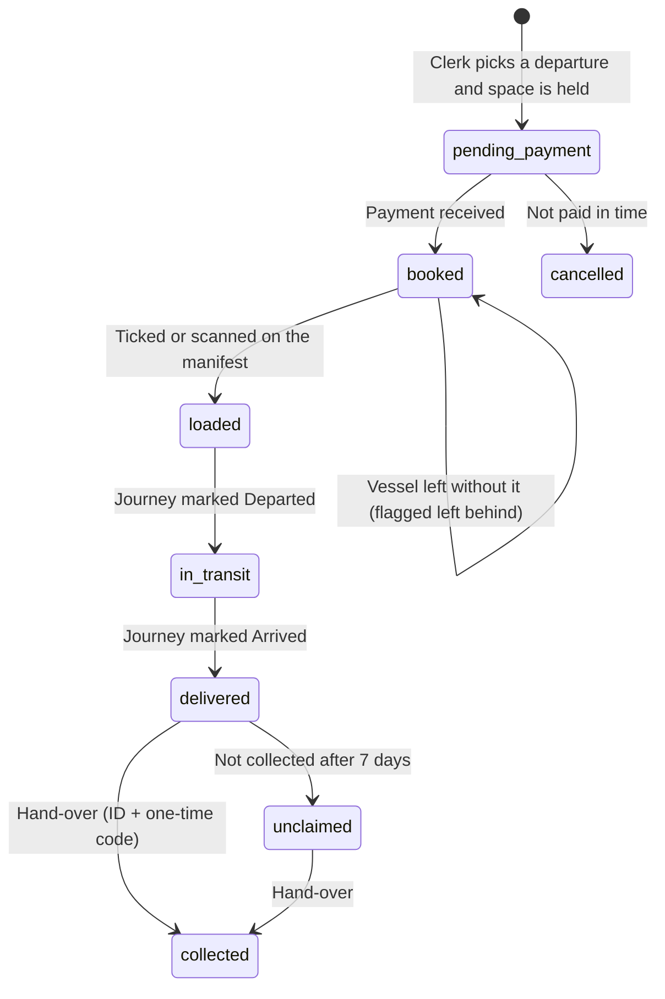

# Cargo Platform — Current-State Review and Gap Analysis

| | |
|---|---|
| **Document** | 01 of 3 — read this first |
| **Version** | 1.2 — sections 5 and 6 updated after your two rounds of comments on 15 November 2026; the findings are unchanged |
| **Date** | 15 November 2026 |
| **Prepared for** | Mafia Fast Ferries — management, commercial, operations, finance and IT |
| **Companion documents** | [02 System Requirements Document](02_SYSTEM_REQUIREMENTS_DOCUMENT.md) · [03 Implementation Plan](03_IMPLEMENTATION_PLAN.md) |
| **What was reviewed** | The `cargo` application on branch `cargo-improvement` (commit `7d4b5a5`): 54 models, 62 services, 45 controllers, 113 migrations, the admin screens (Blade), the sales portal (Vue), the scheduled jobs, the tests, and the structure and reference data of the development database `uclp_cargo`. Nothing was changed. |

---

## 1. Summary

The platform today is a well-built **retail parcel counter**: a clerk picks a departure, enters the cargo, takes payment, and port staff load, depart, arrive and hand over. Pricing, payments, approvals and audit are solid and worth keeping.

It does not yet fit the business you described, for four reasons:

1. **A parcel must be tied to a ferry and a time when it is booked.** There is no way to receive a parcel now and decide later which sailing carries it, and there is no tray.
2. **A cargo type can be charged on one basis only** — weight, or volume, or per piece. Weight and volume cannot be combined, and the value charge is set per fare instead of per cargo type.
3. **There is no contract business.** Customers, quotations, contracts, invoices, credit, charters, laytime, demurrage and despatch do not exist in any form.
4. **Selling is in TZS only**, although every fare already holds a USD price.

The good news is that most of the hard foundations are already in place, so this is an extension, not a rewrite. Section 5 lists what is kept, what is extended and what is replaced.

---

## 2. The system at a glance

| Area | What exists today |
|---|---|
| Technology | Laravel 12 on PHP 8.5, PostgreSQL. Admin portal in Blade + Alpine. Sales portal as a Vue 3 single-page app. Queue and scheduler on the database driver. |
| Network | Stations, routes, trips (times), schedules (a vessel on a trip, by weekday), and journeys generated 30 days ahead by `cargo:generate-services`. |
| Vessels | "Transport units" with one cargo capacity record each: lane metres, weight (kg) and volume (CBM). |
| Cargo types | 24 types in 6 categories (vehicle, freight, parcel, electronics, livestock, special), each priced by exactly one unit: kg, CBM, piece or vehicle. |
| Fares | One fare per type and route (optionally per vessel), versioned with start and end dates, changed only through preview and approval. |
| Booking | Four steps in both portals: **Departure → Cargo → Sender & receiver → Review & pay**. Space is held for 10–15 minutes while the clerk works. |
| Payment | Cash, USSD push (five mobile-money channels) and Lipa Namba. A booking stays "awaiting payment" until money arrives; unpaid bookings are cancelled automatically. |
| Port operations | Load (tick or scan on the manifest) → **Depart** → **Arrive** → hand-over with the collector's ID and a one-time code sent to their phone. |
| Customer contact | SMS to sender and receiver on payment, departure and arrival. Public tracking page with masked names. |
| Control | Maker-checker approvals ("dual control") for 70 kinds of change, a tamper-evident audit log, two-factor sign-in, roles and permissions, shifts for sales officers, close-of-business SMS. |
| Reports | Seven cargo reports (sales summary, booking register, collections and cash-up, capacity, cargo mix, cancellations, uncollected) with Excel and PDF export. |
| Data in the development database | 25 bookings, 26 lines, 252 journeys, 2 active vessels (Kilimanjaro I, Mafia Express), 3 real routes (Dar–Zanzibar, Zanzibar–Dar, Dar–Mafia), 48 live fares. No production history to protect. |

### How a booking moves today

Two points in this diagram matter for what follows. The first arrow needs a departure before anything else can happen. And the status called `delivered` actually means "arrived at the destination port".

---

## 3. Strengths to keep

These parts are sound and the new work should build on them rather than replace them.

| Strength | Where | Why it matters for the new scope |
|---|---|---|
| One pricing engine for both portals; the browser never sends a price | [CargoFareCalculator.php](../app/Services/Cargo/CargoFareCalculator.php) | Multi-basis charging and contract rates can be added in one place. |
| Every booked line keeps its own copy of how it was priced | `cargo_items.pricing_snapshot`, `unit_rate`, `fare_version` | Audits and reports stay correct when fares change. The same idea is needed for quotations and contracts. |
| Fares are versioned and dated, never edited in place | [CargoFareService.php](../app/Services/Cargo/CargoFareService.php), [CargoFare.php](../app/Models/CargoFare.php) | The pattern can be reused for charter rate cards and contract rates. |
| Maker-checker registry with dated changes | [config/dual_control.php](../config/dual_control.php) | Quotation approval, credit overrides, invoice voids and laytime statements can use it without a second approval engine. |
| No overbooking: space is held and committed under a row lock | [CargoInventoryService.php](../app/Services/Cargo/CargoInventoryService.php) | The same discipline extends to shared and exclusive vessel capacity. |
| Payment attempts with channels, callbacks, timeouts and a ledger entry | [CargoPaymentService.php](../app/Services/Cargo/CargoPaymentService.php) | Counter payments for parcels stay as they are. |
| Hand-over with ID and a one-time code | [CargoHandoverService.php](../app/Services/Cargo/CargoHandoverService.php) | The one-time-code mechanism can also confirm a quotation acceptance or countersign a statement of facts. |
| Tracking events for every status change, and a public tracking page | [CargoTrackingService.php](../app/Services/Cargo/CargoTrackingService.php), [PublicTrackingService.php](../app/Services/Cargo/PublicTrackingService.php) | Chain of custody for trays and pieces fits the same model. |
| Exchange rates with a date in force and a "rate due" prompt | `ExchangeRateService`, header chip | Dual-currency documents need exactly this. |
| Report engine with filters and exports | [CargoReportService.php](../app/Services/Cargo/CargoReportService.php) | New reports plug in. |

---

## 4. Findings

Each finding states what was observed, the evidence, and why it matters. Severity: **High** blocks the new business; **Medium** causes friction or risk; **Low** is housekeeping.

### 4.1 Fit with the parcel operation you described

| # | Finding | Evidence | Severity |
|---|---|---|---|
| F-01 | **A parcel cannot be received without choosing a sailing.** The first booking step is the departure list, space is held on that departure, and the booking stores it as a required field. | `STEPS = ['Departure', 'Cargo', 'Sender & receiver', 'Review & pay']` in [CargoBooking.vue](../resources/js/portal/views/cargo/CargoBooking.vue); `bookableDepartures()` and `holdCart()` in [BuildsCargoCart.php](../app/Http/Controllers/Cargo/Concerns/BuildsCargoCart.php); `consignments.transport_service_id` is NOT NULL. | High |
| F-02 | **There is no tray.** Nothing groups parcels into a unit that is sealed, boarded and unpacked as one. | No table, model or screen; a search of the code for tray, cage or pallet finds nothing. | High |
| F-03 | **Pieces are not tracked individually.** A line of 10 cartons has one label and one status, so the cartons cannot be split across trays or sailings. | `cargo_items.quantity` with a single `qr_code_token` per line; `CargoTrackingService::logEvent()` sets every line to the booking's status. | High |
| F-04 | **There is no "received" stage and no place of custody.** A paid booking is "booked" until it is loaded. The system does not know which office holds the parcel, and staff have no duty station. | Statuses in [CargoUi.php](../app/Support/CargoUi.php); the `users` table has no station column. | High |
| F-05 | **A booking cannot be moved to another sailing.** If the vessel leaves without it, the booking is flagged "left behind" but stays attached to the departed journey. | `CargoOperationsService::departed()` sets `left_behind_at`; there is no reassign action anywhere. | High |
| F-06 | **"Arrived" and "ready to collect" are the same thing.** Marking the journey arrived makes every booking collectable, with no offloading or unpacking check, and no way to record a short, extra or damaged piece. | `CargoOperationsService::arrived()` sets `delivered` for all bookings in transit; the scanner's "offloaded" scan does not affect the booking. | Medium |
| F-07 | **The scanner interface only loads and offloads.** It cannot receive, tray, board a tray or unpack. | [ScannerCargoController.php](../app/Http/Controllers/Cargo/Scanner/ScannerCargoController.php) | Medium |
| F-08 | **Status names will confuse.** `delivered` means "arrived at port", and the estimated arrival shown on public tracking is never filled in. | `logEvent(..., 'delivered', 'Arrived … ready for collection')`; `estimated_arrival_at` is read in `PublicTrackingService` and written nowhere. | Low |

### 4.2 Pricing and currency

| # | Finding | Evidence | Severity |
|---|---|---|---|
| F-09 | **One charge basis per cargo type.** The type has a single unit (kg, CBM, piece or vehicle) and the calculator picks exactly one rate. Weight and volume cannot both be charged. | `measurement_unit` validated as `in:kg,cbm,unit,lane_meter` in `AdminCargoController::validateCargoType()`; the `match` in `CargoFareCalculator::baseFare()`. | High |
| F-10 | **The value charge belongs to the fare, not the cargo type.** Whether the clerk must enter a declared value depends on the route. In the current data, TV/Screen and General Freight charge on value on one route and not on the other. | `cargo_fares.value_charge_pct`; `CargoFareCalculator::valueCharge()`. | High |
| F-11 | **The fare table already holds every rate that is needed.** Flat, per-kg and per-CBM prices in TZS and USD, a minimum charge and a value percentage are all columns today. What is missing is the cargo type declaring which of them apply, and the calculator adding them. | `cargo_fares` columns `price_*`, `price_per_kg_*`, `price_per_cbm_*`, `min_charge_*`, `value_charge_pct`. | Good news |
| F-12 | **Selling is in TZS only.** The quote and the booking both pass the fixed value `'TZS'` to the calculator, although the calculator supports USD and all 48 live fares have a USD price. | `quoteCart()` and `bookCart()` in [BuildsCargoCart.php](../app/Http/Controllers/Cargo/Concerns/BuildsCargoCart.php); no currency control on either booking screen. | High |
| F-13 | **Weight bands are separate cargo types** (Small under 5 kg, Medium 5–30 kg, Large 30–100 kg), so the clerk has to pick the right band by hand. There are no rate tiers. | `cargo_types` rows `PCL-SMALL`, `PCL-MEDIUM`, `PCL-LARGE`. | Medium |
| F-14 | **Surcharges are global settings**, not per route or type, and there is no express, storage or fuel surcharge. Ledger categories for storage, insurance and surcharges exist but nothing posts to them. | `cargo_fragile_surcharge_pct`, `cargo_hazmat_flat_fee_*` in settings; `transaction_categories`. | Medium |
| F-15 | **About half of the live fares are placeholders.** Most weight- and volume-priced types carry only a flat 50,000 and no per-kg or per-CBM rate, so those types are hidden from booking. The tariff has to be keyed properly before go-live, which makes this the right moment to change the model. | Fares by type in `uclp_cargo`; `CargoFareCalculator::pricedTypeIds()`. | Medium |

### 4.3 Fit with contract cargo (charter and freight)

| # | Finding | Evidence | Severity |
|---|---|---|---|
| F-16 | **There are no customer accounts.** Sender and receiver are typed onto each booking. Nothing holds a company, its tax numbers, contacts, credit terms or history. | No `customers` table; only a `customer_statuses` lookup with three rows. | High |
| F-17 | **There is no quotation, contract or invoice.** The only financial documents are the counter receipt and the payment attempt. No numbering series, tax, credit note, receivable, statement or ageing. | Tables `cargo_receipts`, `cargo_payments`, `transactions`. The older `payments` and `receipts` tables are leftovers with no rows. | High |
| F-18 | **A vessel cannot be chartered.** There is no exclusive use, no reserved share of capacity for a customer, no vessel calendar, and every journey must come from a recurring schedule. | `transport_services.schedule_id` is NOT NULL; journeys are created only by [GenerateTransportServices.php](../app/Console/Commands/GenerateTransportServices.php). | High |
| F-19 | **Nothing records port time.** A journey has a status, actual departure and arrival times and a free-text weather note. There is no notice of readiness, statement of facts, laytime, demurrage or despatch. | `transport_services` columns. | High |
| F-20 | **The vessel record is shaped for a passenger ferry.** It has seats and a seat layout. Cargo capacity is lane metres, kg and CBM, with placeholder values (for example 2,000 lane metres and 2,000 kg on Mafia Express). There is no vessel class, deadweight, deck area, deck strength, ramp limit or passenger limit. | `transport_units`, `cargo_capacities`. | High |
| F-21 | **The agency float module is not a basis for customer credit.** It comes from the passenger system, refers to a `Booking` class that no longer exists, and cargo has never used it (0 of 25 bookings, channel switched off). | [FloatManagementService.php](../app/Services/FloatManagementService.php); `payment_methods.agent-float` inactive. | Medium |

### 4.4 Engineering and quality

| # | Finding | Evidence | Severity |
|---|---|---|---|
| F-22 | **The tests run against the development database.** `phpunit.xml` points at `uclp_cargo` and carries the database password in plain text. Four cargo test files have no rollback at all, and the passenger-era tests refer to classes that were removed. The full suite cannot be run safely, so there is no automated safety net for a change of this size. | `phpunit.xml`; `CargoAdminCrudTest`, `CargoBookingFlowTest`, `CargoPermissionsTest`, `CargoPortalAuthTest`; `database/factories` is empty. | High |
| F-23 | **Capacity is a set of running totals with no record behind them.** Used and held space are counters on each journey, repaired by `cargo:recount-inventory`. That works for one source of bookings. It will not stay correct with assigned trays and big parcels, shared cargo bookings, exclusive charters and tentative holds all drawing on the same vessel. | `cargo_inventories.used_*`, `held_*`; three counter columns are unused. | High |
| F-24 | **Status values are plain text scattered through the code** — services, controllers, both portals, reports, SMS and tracking. Two service lines with more states need one definition of what can follow what. | For example `CargoOperationsService`, `CargoManifestService::MANIFEST_STATUSES`, `CargoUi::STATUS`, `PublicTrackingService::MILESTONES`. | Medium |
| F-25 | **Passenger-ferry leftovers remain.** Twenty-seven files refer to models that no longer exist (`Booking`, `Voyage`, `Ticket`, `Ferry`). One of them, `voyage:generate`, is still scheduled every night at 00:05 and can only fail. Empty tables (`fares`, `passengers`, `payments`, `receipts`, `promotions`) remain. | [routes/console.php](../routes/console.php); [GenerateVoyages.php](../app/Console/Commands/GenerateVoyages.php). | Low |
| F-26 | **The same admin endpoints are declared in three places** (session routes in `web.php`, and token and session copies in `api.php`). New endpoints should go in one place. | [routes/web.php](../routes/web.php), [routes/api.php](../routes/api.php). | Low |
| F-27 | **Money is stored in two styles.** Some tables have separate TZS and USD columns and infer the currency from which one is above zero; the ledger stores amount, currency, rate and TZS equivalent. Contracts and invoices need the second style throughout. | `Consignment::getBillingCurrencyAttribute()`; `transactions`. | Medium |

---

## 5. What is kept, extended and replaced

| Component | Decision | Reason |
|---|---|---|
| Pricing engine, fare versioning, price snapshot on each line | **Extend** | Add charge bases per cargo type, all added, rate tiers, USD selling and contract rates. Remove the surcharges: a price comes only from the cargo type's fare. |
| Cargo type and fare screens | **Extend** | The type form gains charge bases; the fare editor shows one rate field per basis. |
| Booking screen (both portals) | **Rework** | Becomes "Receive parcel" with no departure step, for every cargo type. Later the assigner puts parcels in trays for a sailing and assigns big parcels and vehicles to it; boarding only confirms. |
| Space holds on a departure | **Move; replace the bookkeeping** | Nothing is held at the counter any more. Space is held when the assigner assigns a parcel, tray or big parcel to a sailing, and recorded in a capacity ledger shared by parcels and contract bookings. |
| Booking, line and tracking tables | **Extend** | Add service type, origin and destination station, received details, pieces, tray and sailing references. |
| Journeys, manifest, depart and arrive | **Extend** | Add trays and big parcels to the manifest, release of what a departed or cancelled sailing did not carry, ad-hoc charter voyages, exclusive and shared use, port calls. |
| Hand-over with one-time code | **Keep**, add partial collection | Works well. |
| Payments, ledger, cash-up, shifts, close of business | **Keep** | Counter operation is unchanged. Invoices and customer receipts are added beside them. |
| Dual control, audit log, roles, menus, notifications, exchange rates | **Keep and register new items** | New approvals, permissions, menus and templates are added through the existing mechanisms. |
| Reports engine | **Extend** | New parcel, commercial, laytime and receivables reports. |
| Agency float, passenger-era services and tests | **Leave alone** | Not used by cargo. Only the failing nightly `voyage:generate` entry is removed. |
| Test setup | **Fix first** | A separate test database before any feature work (Phase 0 of the plan). |

---

## 6. Gap matrix

| Capability you asked for | Today | Gap |
|---|---|---|
| Receive a parcel, assign it later | Ferry and time fixed at booking | New receiving flow, piece labels, backlog by destination |
| Assign to tray | None | Tray register; assigning parcels to trays and trays to sailings, with space held; sealing |
| Boarded / in transit / arrived | Present per booking | Move to trays and pieces; add unpacking and discrepancies |
| Charge per CBM, per weight, per value, or all together | One basis per type; value charge per fare | Charge bases on the cargo type; calculator adds all of them |
| TZS and USD | Rates stored in both; selling in TZS only | Currency on every booking, quotation, invoice and receipt |
| Whole-vessel lease | None | Exclusive voyages and time-charter periods on a vessel calendar |
| Part-capacity booking on a shared vessel | None | Capacity ledger with reservations per customer |
| Negotiation, quotation, agreed terms | None | Customers, quotations with revisions and approval, contracts |
| Invoice on agreement | None | Invoices, credit notes, receipts, statements, tax |
| Time charter, voyage charter, per-unit freight, project contract | None | Four contract types with their own pricing and invoicing rules |
| Laytime, notice of readiness, demurrage, despatch | None | Port calls, statement of facts, laytime calculator, statements |
| Safe operation of a landing craft | Weight, volume and lane-metre limits only | Vessel limits, dangerous goods, pre-departure checklist, Master's hold |

The requirements that close these gaps are in [document 02](02_SYSTEM_REQUIREMENTS_DOCUMENT.md); the order of work, files and database changes are in [document 03](03_IMPLEMENTATION_PLAN.md).
