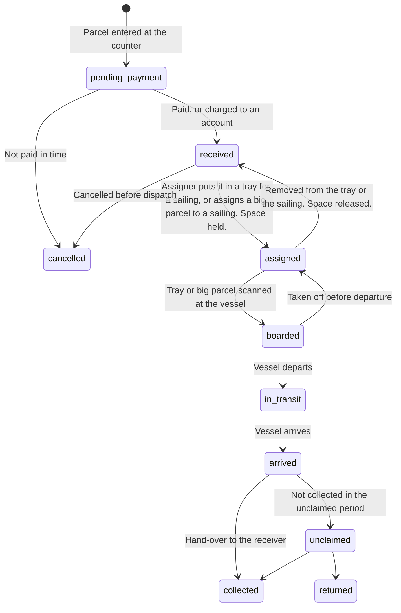
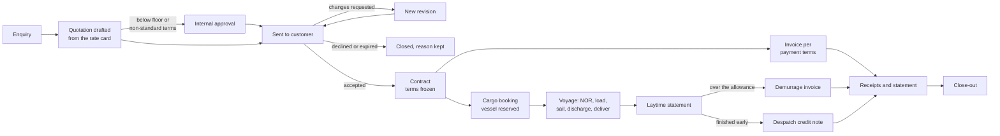
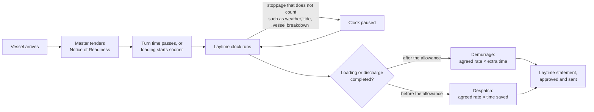
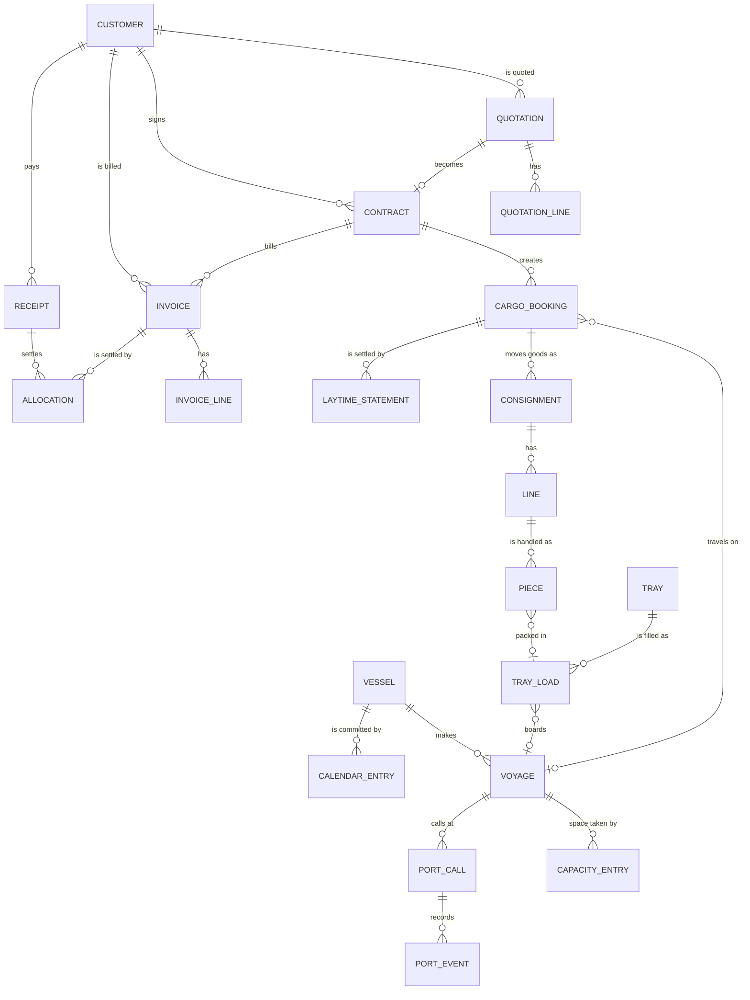

# System Requirements Document — Parcel Service and Contract Cargo

| | |
|---|---|
| **Document** | 02 of 3 |
| **Version** | 1.3, approved on 15 November 2026 |
| **Date** | 15 November 2026 |
| **Prepared for** | Mafia Fast Ferries — management, commercial, operations, finance and IT |
| **Perspectives covered** | Software engineering, quality assurance, marine operations and the Designated Person Ashore (DPA), business strategy, systems analysis |
| **Companion documents** | [01 Current-State Review](01_CURRENT_STATE_REVIEW.md) · [03 Implementation Plan](03_IMPLEMENTATION_PLAN.md) |
| **Status** | Approved. Each phase of [document 03](03_IMPLEMENTATION_PLAN.md) is delivered in its own session, tracked in [04_TASK_TRACKER.md](04_TASK_TRACKER.md). |

### Changes since version 1.2

You approved version 1.2 on 15 November 2026, with one change.

| Your comment | What changed | Where |
|---|---|---|
| Add a flat price in place of the minimum charge (D-30) | A fare can carry a flat price: the least a line pays. Small parcels pay the flat price; larger ones pay their charges. Rate bands now apply each band's rate only to the quantity within it, so a heavier parcel never costs less than a lighter one. Version 1.2's example E did not guarantee that: a 6 kg parcel cost less than a 5 kg one. | Glossary, TAR-04, TAR-05, TAR-10, TAR-18, 5.1, example E, sections 9 to 11 |
| Approved | Status updated. Every recommendation in section 11 is accepted; the items still to be supplied are listed in the task tracker. | Header, section 11 |

Version 1.2 took in your second comments: assignment holds space, boarding only changes the status, a price comes only from the cargo type's fare, and the late-collection charge has a percentage (0 for none) and a grace period. Version 1.1 took in your first comments.

### How to review this document

| If you are… | Read | And check |
|---|---|---|
| Management | Sections 1–3 and 11 | That the two service lines and the four ways of earning match the business. Answer the decisions in section 11. |
| Commercial team | Sections 3.2–3.4, 4.7–4.9, 4.13–4.14, 5.3–5.6 | Quotation and contract steps, default terms, approval limits. |
| Operations, Masters, DPA | Sections 3.1, 3.5, 4.2–4.6, 4.10–4.12, 4.17, 5.4 | Assignment and tray handling, boarding, port time recording, safety gates. |
| Finance | Sections 4.15–4.16, 5.5–5.9 | Invoicing, tax, currency rules, the late-collection charge and the worked examples. |
| IT | All, then document 03 | Data, interfaces and non-functional requirements. |

Every requirement has an identifier, a priority and a phase. **M** = must have for the service line to work, **S** = should have, **C** = could have (optional). Phases 0 to 7 are defined in document 03.

---

## 1. Introduction

### 1.1 Purpose

This document states what the cargo platform must do to run two businesses side by side:

1. **Parcel service** on the ferries — a counter operation where parcels are received, grouped into trays, boarded, carried and collected.
2. **Contract cargo** on the landing craft — negotiated work where the commercial team quotes, the customer agrees, an invoice is raised, and the vessel is either leased whole or shared between customers.

### 1.2 Scope

**In scope**

- Parcel receiving without a sailing, assignment to trays and sailings with space held, boarding, arrival, unpacking, collection and the late-collection charge.
- Tariffs that charge per CBM, per kg, per piece and on declared value, alone or together.
- Customer accounts, enquiries, quotations, contracts and cargo bookings.
- Four contract types: time charter, voyage charter, per-unit freight and project contract.
- Whole-vessel and part-capacity use of a vessel, on one capacity record.
- Notice of readiness, statement of facts, laytime, demurrage and despatch.
- Invoices, credit notes, receipts, statements and ageing in TZS and USD.
- Safety controls for cargo operations, approvals, audit, notifications and reports.

**Out of scope for this programme**

- Passenger ticketing (a separate system).
- Door-to-door delivery beyond the destination office.
- Customs clearance and port authority filings.
- A general ledger. The platform issues invoices and receipts and exports them; the accounting system remains the book of record.
- Crew, payroll, planned maintenance and fuel management beyond what a charter needs.

### 1.3 Business objectives

| # | Objective | How it will be measured |
|---|---|---|
| O1 | Receive a parcel without deciding which ferry carries it | A clerk completes a receipt in four steps with no departure step |
| O2 | Know where every piece is and who handled it | Each piece has a label and a recorded scan at tray, boarding, arrival and collection |
| O3 | Stop parcels sitting unnoticed | Backlog by destination is visible to the counter and operations; ageing alerts fire |
| O4 | Price the way the business charges | A cargo type can combine weight, volume and value charges, in TZS or USD |
| O5 | Run contract cargo in the system from enquiry to cash | Every charter and freight job has a quotation, a contract, invoices and receipts |
| O6 | Recover demurrage reliably | Laytime is calculated from recorded facts, and the demurrage invoice is ready within three working days of completion |
| O7 | Never sail outside the vessel's limits | The system refuses to assign, reserve or load beyond limits, and the Master's sign-off is recorded for each landing-craft voyage |
| O8 | Give management one view | Utilisation, pipeline, receivables and backlog on one dashboard |

### 1.4 Glossary

| Term | Meaning in this document |
|---|---|
| **Parcel** | Goods received at a counter for carriage on a ferry, paid at tariff. |
| **Consignment** | One receipt of goods from a sender to a receiver. It has one or more lines. |
| **Line** | One cargo type on a consignment, with its quantity, weight, size and value. |
| **Piece** | One physical package with its own label. A line of three cartons has three pieces. |
| **Lot** | A labelled group of identical packages counted together (for example 200 bags). A lot can be split. |
| **Tray** | A reusable carrier for parcels — a cage, trolley, pallet, bin or bag — with a barcode. |
| **Tray load** | One filling of a tray for one sailing: opened, filled, sealed, boarded, unpacked. The tray is then free again. |
| **Assignment** | Putting a parcel into a tray that is open for a sailing, or a big parcel directly onto a sailing. The item's space on that sailing is held from that moment. Done by the **assigner**. |
| **Loose piece** | A parcel too big for a tray, or a vehicle. The assigner assigns it to a sailing directly, and it travels as it is. |
| **Late-collection charge** | A percentage of the parcel's charge, payable by the receiver when the parcel is not collected within the grace period. |
| **Sailing / journey / voyage** | One trip of a vessel from one place to another. "Sailing" is used for scheduled ferry trips and "voyage" for landing-craft trips; the system holds both in the same record. |
| **Charge basis** | What a tariff multiplies: pieces, kilograms, cubic metres (CBM), or a percentage of the declared value. |
| **Flat price** | The least a parcel of a cargo type pays on a route, set on its fare. Small parcels pay the flat price; larger ones pay their charges. |
| **Ad valorem** | A charge that is a percentage of the declared value of the goods. |
| **Charter** | Hiring a vessel. The customer is the **charterer**; the company is the **owner**. |
| **Time charter** | The customer hires the vessel and crew for a period at a daily or monthly rate. |
| **Voyage charter** | A fixed price for one trip. |
| **Per-unit freight** | A price per tonne, truck, container or other unit on a regular route. |
| **Project contract** | A long-term agreement to carry cargo for one site at agreed rates. |
| **Laycan** | The window of dates in which the vessel must present for loading. |
| **Notice of Readiness (NOR)** | The Master's formal notice that the vessel has arrived and is ready to load or discharge. |
| **Laytime** | The time the contract allows the customer for loading and discharging. |
| **Statement of Facts (SOF)** | The timed record of what happened at the port: arrival, notice, start, stoppages, finish. |
| **Demurrage** | Money the customer pays for time beyond the laytime, at the rate the contract states, per day or per hour. |
| **Despatch** | Money credited to the customer for finishing before the laytime runs out, at the rate the contract states. It is often half the demurrage rate. |
| **Detention** | A higher charge when a vessel is held far beyond the laytime (optional term). |
| **Deadfreight** | Freight payable on cargo the customer agreed to ship but did not. |
| **Off-hire** | Time during a time charter when the vessel is unavailable through the owner's fault; no hire is paid. |
| **SHINC / SHEX** | Sundays and holidays included in laytime / excepted from laytime. |
| **Reversible laytime** | Loading and discharging time are pooled into one allowance. |
| **Turn time** | A notice period between the NOR and the start of laytime. |
| **Dangerous goods (DG)** | Goods classified as hazardous for carriage by sea. |
| **DPA** | Designated Person Ashore: the shore manager responsible for safe operation, with direct access to top management. |
| **Dual control** | The platform's maker-checker approval: one person proposes, another approves. |

### 1.5 References

- [00 Master Plan](00_MASTER_PLAN.md) (September 2026), the original vision for the platform.
- International Safety Management (ISM) Code — role of the DPA and the Master's overriding authority.
- International Maritime Dangerous Goods (IMDG) Code — classification and segregation of dangerous goods.
- Code of Safe Practice for Cargo Stowage and Securing (CSS Code).
- BIMCO Laytime Definitions for Charter Parties — vocabulary for laytime terms.
- Requirements of the maritime and revenue authorities that apply to the company. These are named where relevant and listed for confirmation in section 11.

---

## 2. Overall description

### 2.1 Two service lines

| | Parcel service | Contract cargo |
|---|---|---|
| Customer | Anyone at the counter; account customers later | Companies, government bodies, projects |
| How the price is set | Published tariff by cargo type and route | Negotiated quotation, guided by a rate card |
| When money is due | Before the parcel is accepted (or on account) | By invoice, on the agreed payment terms |
| Vessel | Scheduled ferries (and landing-craft sailings with space) | Landing craft, whole or shared |
| The vessel is decided | At assignment, when the assigner puts the parcel in a tray for a sailing or assigns a big parcel to it; its space is held from then | At contract, as a reservation of the vessel or part of it |
| Unit of handling | Piece → tray → sailing | Truck, container, equipment, bulk lot → voyage |
| Journey of the goods | Received → assigned to tray → boarded → in transit → arrived → collected | Gated in → loaded → sailed → discharged → delivered |
| Time at port | Not charged | Laytime, demurrage and despatch may apply |
| Documents | Receipt, piece labels, tray manifest | Quotation, contract, invoice, NOR, SOF, laytime statement, manifest, waybill, delivery note |
| Typical value | Small, many per day | Large, few per week |

Both lines share customers, vessels, sailings, the capacity record, the manifest, tracking, approvals, audit and reporting.

### 2.2 Users and roles

| Role | New? | Works in | Main tasks |
|---|---|---|---|
| Counter clerk (sales officer, booking officer, counter staff) | Existing | Sales portal | Receive parcels, take payment, print receipt and labels |
| Assigner (warehouse) | New | Sales portal on a phone or tablet, or the admin dispatch board | Assign parcels to trays and trays to a sailing; assign big parcels and vehicles to a sailing; seal trays; unpack at destination |
| Port officer | Existing | Sales portal and admin | Scan trays and big parcels on board (marks them Boarded), depart and arrive sailings, hand over |
| Operations manager | New | Admin | Dispatch board, vessel calendar, voyages, review of port records |
| Vessel Master | New | Sales portal on a phone or tablet | Tender NOR, record port events, sign the pre-departure checklist, hold or refuse cargo |
| Commercial officer | New | Admin | Customers, enquiries, quotations |
| Commercial manager | New | Admin | Approve quotations, contracts, discounts |
| Finance officer | Existing | Admin | Invoices, receipts, statements |
| Finance manager | New | Admin | Approve credit notes, voids, credit limits |
| DPA / safety officer | New | Admin | Dangerous-goods acceptance, safety holds, incidents; reads everything |
| Administrator | Existing | Admin | Set-up, users, tariffs, settings |
| Agency staff | Existing | Sales portal | Receive parcels at an agency, unchanged in principle |
| Customer | External | Email, SMS, public pages (a portal is optional later) | Receives quotations, invoices and notices; confirms acceptance |

**What changes for each person**

| Person | Today | After |
|---|---|---|
| Counter clerk | Chooses a departure, then enters the parcel | Enters the parcel; the system shows the expected sailing |
| Assigner | Nobody does this today | Opens a tray for a sailing and scans parcels in, seeing the tray's fill and the sailing's space left at each scan; assigns big parcels and vehicles to a sailing |
| Port staff | Tick bookings on a manifest | Scan trays and big parcels at the vessel to mark them boarded; scan them out on arrival |
| Operations | Watch each departure fill up | See what is waiting and for how long, what is assigned to each sailing, and the space left |
| Commercial team | Quote by email and spreadsheet | Quote in the system from a rate card, with approval and a record |
| Finance | Counter cash-up only | Invoices, receipts, statements and ageing as well |
| Master | Paper log | Records NOR and port events on a phone; signs the checklist |

### 2.3 Operating environment

The existing platform is kept: Laravel 12 on PHP 8.5, PostgreSQL, the admin portal (Blade and Alpine), the sales portal (Vue 3), SMS through the configured gateways, email through the configured servers, PDF generation on the server, and the scheduler and queue worker. Port and vessel tasks must work in a mobile browser on a phone with a weak connection.

### 2.4 Assumptions and constraints

| # | Assumption or constraint |
|---|---|
| A1 | A tray is a physical, reusable carrier that can be given a barcode label. (Confirmed.) |
| A2 | Parcels travel point to point on one sailing. Multi-stop sailings are allowed for by the design but not built now. |
| A3 | Vehicles on the ferries are unlikely but are accepted. A vehicle never goes in a tray. Like any parcel too big for a tray, the assigner assigns it to a sailing directly and it is boarded as it is. |
| A4 | Counter parcels are paid before acceptance, as today. Account and pay-on-collection options are additions. |
| A5 | Contract cargo is always priced by a quotation, even when the price comes straight from the tariff. |
| A6 | The company trades in TZS and USD only. Other currencies in the currency table are not used. |
| A7 | Tax treatment and fiscal-receipt rules will be confirmed by finance; the system makes them configurable rather than fixed. |
| A8 | There is no live production history. The 25 bookings in the development database are test data. |
| C1 | Every change follows the project's working agreement: plan, approval, tracked implementation, walkthrough, then accept or reject. |
| C2 | The scheduler and a queue worker must be running in production; several features depend on them. |

### 2.5 Design principles

1. **Receive first, assign later, board only what was assigned.** Custody starts at the counter. The assigner decides the sailing and holds its space; boarding confirms it.
2. **Track what is physically handled.** Pieces, trays, units. A status on a booking is a summary of those.
3. **One capacity record per sailing.** Assigned and boarded trays, parcels and big parcels, shared cargo, exclusive charters and tentative holds all draw on it, so a vessel is never loaded past its limits.
4. **One pricing engine.** Tariff, contract rates and quotations use the same rules and keep a copy of how each price was reached.
5. **Agreed terms are frozen.** A sent quotation, a contract, an issued invoice and an approved statement are never edited; they are revised, amended or credited.
6. **Facts before money.** Demurrage and despatch are computed from recorded events, and the calculation can be reproduced.
7. **Safety outranks sales.** Commercial users cannot override a vessel limit, a safety hold or the Master.
8. **Two people for anything that moves money or risk.** Use the existing maker-checker registry.
9. **Show the state where people already look.** Chips and badges for backlog, expected sailing, laytime remaining, credit and due dates.
10. **Build on what works.** Extend the existing engine, tables and screens; do not start a second system inside the first.

---

## 3. Business processes

### 3.1 Parcel: received → assigned to tray → boarded → in transit → arrived → collected



| Step | Who | What happens | What the system records |
|---|---|---|---|
| 1. Receive | Counter clerk | Destination, parcels (type, pieces, weight, size, value), sender and receiver, payment. No sailing is chosen. | Consignment, lines, one labelled piece per package, price breakdown, payment, receiving station and clerk. Status **Received**. |
| 2. Assign | Assigner | Picks a coming sailing and sees its space left. Opens a tray for that sailing and scans parcels in: each scan checks the tray's limits and the sailing's space left, and holds the parcel's space. Assigns parcels too big for a tray, and vehicles, to the sailing directly with the same check. Seals each full tray. | The tray's sailing; each parcel's tray and the space it holds on the sailing; by whom and when. Status **Assigned to tray**, or **Assigned to sailing** for a big parcel. |
| 3. Board | Port officer | Scans each tray tag and big parcel at the vessel. The scan only marks it boarded, and is refused for anything not assigned to that sailing. | Status **Boarded**, by whom and when. The space held does not change. |
| 4. Depart | Port officer | Marks the sailing departed. Anything assigned but not boarded loses its space on that sailing and is listed for the assigner to move to a later one. | Status **In transit**; SMS to sender and receiver. |
| 5. Arrive and unpack | Port officer and assigner at destination | Marks the sailing arrived; scans each tray out; any missing, extra or damaged piece is reported. | Status **Arrived**; pieces ready for collection; SMS to the receiver. |
| 6. Collect | Port officer | Hand-over with the collector's ID and a one-time code (as today). If the late-collection charge applies, it is paid first. | Status **Collected**. |

A consignment's status is the stage of its least advanced piece. When some pieces are ahead, the screens show the count, for example "Boarded 6 of 10".

A big parcel or a vehicle skips the tray: received → assigned to sailing → boarded → in transit → arrived → collected.

No space is held at the counter. Space is held only by assignment, and every limit of the sailing is checked at each assignment, so a vessel can never be assigned more than it can carry. If a sailing leaves without something assigned to it, or is cancelled, that space is released and the dispatch board lists the tray or big parcel with the next sailing that has room, for the assigner to confirm. A tray that loses its sailing keeps its parcels and its seal.

### 3.2 Contract cargo: enquiry → quotation → agreement → invoice → voyage → settlement



| Stage | Who | Output |
|---|---|---|
| Enquiry | Commercial officer | Customer or prospect, cargo, places, dates, special needs |
| Quotation | Commercial officer | Priced lines, terms, validity date; checked against vessel limits and the vessel calendar |
| Approval | Commercial manager | Needed when the price is below the floor, the discount exceeds the officer's authority, the terms are non-standard, or the customer is over credit |
| Negotiation | Commercial officer and customer | Numbered revisions; each one sent is kept |
| Agreement | Customer signatory | Acceptance with evidence: signed copy, purchase order, or a one-time code confirmation |
| Contract and booking | System, then operations | Frozen terms; vessel or capacity reserved; first invoice raised |
| Voyage | Master, port officer, operations | Cargo checked in, loaded and tallied; port events recorded; documents issued |
| Laytime | Operations, then approval | Statement from the recorded facts; demurrage or despatch |
| Settlement | Finance | Receipts allocated; statement; close-out |

### 3.3 Whole vessel or shared vessel

| | Whole vessel (exclusive) | Part capacity (shared) |
|---|---|---|
| What the customer buys | The vessel for a voyage or a period | A stated share: tonnes, deck area or lane metres, or a number of units |
| Other cargo on board | None, unless the customer agrees in writing | Other customers' cargo and parcels up to the vessel's limits |
| Capacity record | The voyage is marked exclusive; every other reservation is refused | Each customer's reservation is recorded; free space is what remains |
| Typical contract | Time charter, voyage charter | Per-unit freight, project call-offs, part-cargo voyage charter |
| Laytime | Usually applies | Usually does not apply; waiting charges can be agreed |
| On the calendar | The vessel shows as taken | The voyage shows percentage filled |

### 3.4 The four ways the business earns

| | Time charter | Voyage charter | Per-unit freight | Project contract |
|---|---|---|---|---|
| Customer pays for | Time: vessel and crew by the day or month | One trip from A to B | Each tonne, truck, container or other unit | Agreed rates over a long period for one site |
| Price in the system | Daily or monthly rate × time on hire | Lump sum, or rate × quantity with a minimum | Unit rate × units carried | Contract rate card, per shipment |
| Vessel use | Whole | Whole, or part | Shared | Either, per shipment |
| Reservation | A period on the vessel calendar | One voyage | Space on a scheduled voyage | Each call-off reserves a voyage or space |
| Invoicing | In advance, per interval; adjusted at the end | Deposit on agreement, balance per terms | Per shipment, or a monthly statement | Per call-off or monthly, with a shipment list |
| Time risk | Customer carries it; off-hire is credited | Laytime, demurrage, despatch | Normally none; waiting charge if agreed | As agreed per shipment |
| Extra rules | Off-hire, fuel and port costs split, delivery and redelivery | Deadfreight, cancellation fees | No-show and cancellation fees | Minimum commitment, rate reviews |
| Why it matters | Most stable income | Highest price per day when demand is strong | Fills the vessel on regular routes | Predictable base load |

### 3.5 Laytime, demurrage and despatch



The contract sets the allowance, when the clock starts, what stops it and the rates. The Master and port officer record the facts. The system does the arithmetic, shows the clock live, and produces the statement. Section 5.4 gives the rules and worked examples.

---

## 4. Functional requirements

### 4.1 Tariff and charging (TAR)

| ID | Requirement | Pri | Ph |
|---|---|---|---|
| TAR-01 | A cargo type states how it is charged: per CBM, per kg of weight, a percentage of the declared value, or any combination of the three — CBM only, weight only, value only, CBM and value, weight and value, CBM and weight, or all three. The per-piece price used today for envelopes, livestock and vehicles stays available as a fourth basis. | M | 1 |
| TAR-02 | When a type has more than one basis, the price of a line is the **sum** of all of them. | M | 1 |
| TAR-03 | Withdrawn in version 1.1. You confirmed that every basis of a type is added, so the "whichever is greater" option is not built (section 10). | — | — |
| TAR-04 | A fare (cargo type and route) holds a rate in TZS, and optionally USD, for each basis of its type, and optionally a flat price (TAR-18); nothing else. The fare form shows only those fields: a type charged on declared value alone shows only the percentage; a type charged on CBM, weight and value shows all three. For example, a cargo type "Fragile" ticked for CBM, weight and value requires a CBM amount, a weight amount and a percentage on its fare, and all three are calculated. A fare that lacks a rate for one of the type's bases cannot be saved and never prices a parcel. | M | 1 |
| TAR-05 | The price of a line is only the sum of its cargo type's charges, as set when the type was created. No surcharge is added: a fragile, livestock or hazardous item is booked as its own cargo type, whose fare carries its price. The fragile and dangerous-goods marks on a type or a line stay for handling (labels, tray rules, manifest) and do not change the price. A fare can also carry a flat price, the least a line pays (TAR-18). An authorised fare override with a reason remains, as today. | M | 1 |
| TAR-06 | The receiving screen asks for what the type needs: weight for a weight basis, size or volume for a volume basis, declared value for a value basis. | M | 1 |
| TAR-07 | Each line stores the charge for every basis (quantity, rate, amount). Receipts, the booking page and reports show the breakdown without re-reading the fare. | M | 1 |
| TAR-08 | Changing a type's bases is an approved, dated change. The preview lists the fares that will need new rates. If a fare is not ready by the start date, the type is hidden from receiving and flagged. | M | 1 |
| TAR-09 | Fares stay versioned and dated as today: no editing in place, a start date on every change, and the price in force when the parcel is received. | M | 1 |
| TAR-10 | Rate bands: the rate per kg or per CBM can change above set quantities. Each band's rate applies only to the quantity within that band, so a heavier parcel never costs less than a lighter one. With the flat price (TAR-18), one cargo type can cover small, medium and large parcels. | S | 1 |
| TAR-11 | A parcel can be sold in TZS or USD. The price comes from the fare's rate in that currency. | M | 1 |
| TAR-12 | Withdrawn in version 1.2. A price comes only from the cargo type's fare (TAR-05); an express service can be set up as its own cargo type. | — | — |
| TAR-13 | Late-collection charge: when the receiver has not collected a parcel within the grace period (3 days by default), a percentage of the parcel's charge is added and collected at hand-over. The percentage and the grace period are set in system settings; a percentage of 0 means no charge. Rules in section 5.9. | M | 2 |
| TAR-14 | Withdrawn in version 1.2. The fragile, dangerous-goods and livestock surcharges are removed (TAR-05). | — | — |
| TAR-15 | A customer's contract rates take precedence over the public tariff: contract rate, then vessel-specific fare, then route fare. | S | 6 |
| TAR-16 | Withdrawn in version 1.2, for the same reason as TAR-12. A price change driven by fuel is made as a new fare version with a start date. | — | — |
| TAR-17 | A parcel is priced by its route, because the ferry is not known when it is received. A fare for one particular vessel is no longer offered; none is in use today. | M | 2 |
| TAR-18 | A fare can carry a flat price, in TZS and optionally USD. A line never costs less than it: when the type's charges add up to less, the line costs the flat price. It is optional, offered for every cargo type, applies before any approved discount, and is shown on the receipt when it applies. | M | 1 |

### 4.2 Parcel receiving (PRC)

| ID | Requirement | Pri | Ph |
|---|---|---|---|
| PRC-01 | A clerk receives a parcel in four steps — destination, parcels, sender and receiver, review and pay — without choosing a sailing. The origin is the clerk's duty station. | M | 2 |
| PRC-02 | When paid, the consignment is **Received** and in the custody of the receiving station. With a pay-later channel it waits as "Awaiting payment" and cannot be assigned until paid. | M | 2 |
| PRC-03 | Every piece gets a label: consignment number, piece n of N, destination in large type, and a scannable code. A bulk line can be labelled as one lot with its quantity. | M | 2 |
| PRC-04 | The screen and the receipt show the **expected sailing**, estimated from what is already waiting and the space left on coming sailings after what is assigned. It is an estimate; space is held only when the parcel is assigned. Once assigned, the parcel shows its actual sailing. | M | 2 |
| PRC-05 | The counter shows, for each destination, what is waiting (pieces and kg) and the space left on the next sailings. | M | 2 |
| PRC-06 | Vehicles are accepted on the ferries. A cargo type can be marked "never in a tray"; a vehicle is such a type. It is received like any other item, assigned to a sailing by the assigner, who can do so as soon as it is received, and boarded as it is. Choosing the sailing at the counter is not built (section 10). | M | 2 |
| PRC-07 | The customer can ask for "not before" a date. It shows on the dispatch board, and assigning the parcel to an earlier sailing is refused. | S | 2 |
| PRC-08 | Shift rules, fare override with reason, customer autofill by phone, payment channels, receipts and SMS behave as today in both portals. | M | 2 |
| PRC-09 | The clerk confirms a contents declaration. Dangerous-goods types need the class and UN number. Prohibited items are refused. | M | 2 |
| PRC-10 | Photos and a condition note can be attached at receipt. | S | 2 |
| PRC-11 | A received parcel can be re-weighed or re-measured before dispatch. A price difference becomes an extra payment or a refund due, with the change recorded. If the parcel is already assigned, its held space is adjusted, and the change is refused when the sailing has no room for it. | M | 2 |
| PRC-12 | An account customer's parcels can be received "on account" and invoiced periodically. | S | 4 |
| PRC-13 | Freight collect: the receiver pays at the destination before hand-over. | C | 7 |
| PRC-14 | A customer can register a parcel in advance and complete it at the counter. | C | 7 |
| PRC-15 | The clerk can mark a piece "too big for a tray" at receipt, and the assigner can do so later. Such pieces are listed separately on the dispatch board and are assigned to a sailing directly. | M | 2 |
| PRC-16 | The price shown to the clerk is the price charged, provided the receipt is saved within 15 minutes. After that the parcel is priced again and the clerk is told if the amount changed. | M | 2 |

### 4.3 Trays (TRY)

| ID | Requirement | Pri | Ph |
|---|---|---|---|
| TRY-01 | A register of trays: code, type (cage, trolley, pallet, bin, bag), empty weight, maximum weight and volume, home station, current station, status. | M | 2 |
| TRY-02 | The assigner opens a tray load for one sailing by scanning the tray and choosing the sailing; the destination is the sailing's. The tray holds its empty weight, and a tray position where the vessel has a set number, on that sailing. A tray has one open load at a time. | M | 2 |
| TRY-03 | Pieces are added by scanning. The system refuses a piece that is unpaid, cancelled, on hold, for another destination, at another station, already assigned, of a type marked "never in a tray", not allowed before a later date, or that would exceed the tray's limits or the space left on the tray's sailing. An accepted scan holds the piece's weight and volume on the sailing and shows the tray's fill and the sailing's space left. It warns about fragile items and dangerous-goods combinations. | M | 2 |
| TRY-04 | A piece can be removed from an open tray. It returns to the waiting list and its space on the sailing is released. | M | 2 |
| TRY-05 | Closing a tray records the seal number and totals and prints a tray tag and tray manifest. Reopening a sealed tray needs a supervisor and a reason. | M | 2 |
| TRY-06 | A parcel too big for a tray, and any vehicle, travels as it is. The assigner assigns it to a sailing directly, with the same checks as a tray, and its weight, volume and lane metres are held on the sailing. | M | 2 |
| TRY-07 | Each piece and consignment shows its tray and sailing, who assigned it and when. | M | 2 |
| TRY-08 | The system suggests what to load into a tray: oldest first, keeping one receiver's pieces together. | S | 2 |
| TRY-09 | Tray location is tracked, including empty returns, with a count of trays per station. | S | 2 |
| TRY-10 | Before boarding, the assigner can move a tray, open or sealed, or a big parcel to another sailing. Its space moves with it in one step if the new sailing has room. Everything assigned to a sailing can be moved to another sailing in one action, for example when a sailing is cancelled. | M | 2 |

### 4.4 Dispatch board, assignment and boarding (DSP)

| ID | Requirement | Pri | Ph |
|---|---|---|---|
| DSP-01 | A dispatch board per origin station shows what is waiting by destination (pieces, kg, CBM, age of the oldest), open and sealed trays with their sailing, items that missed a sailing, and coming sailings with their space left after what is assigned. The assigner can assign from it at a desk as well as by scanning. | M | 2 |
| DSP-02 | Only the assigner assigns: parcels to trays, trays to a sailing, and big parcels and vehicles to a sailing. Space is held at assignment and checked against every limit of the sailing (weight, volume, lane metres, tray positions), so a sailing can never be assigned more than it can carry, even with several assigners working at once. | M | 2 |
| DSP-03 | Boarding only changes the status. The port officer chooses the sailing being loaded and scans tray tags and big parcels; each scan marks the item Boarded. It is refused for anything not assigned to that sailing, a tray that is not sealed, or an item on hold. Something that must travel but is not assigned is assigned first by the assigner, with the same space check. Boarding closes when the sailing departs. | M | 2 |
| DSP-04 | When the sailing departs, boarded items become In transit. A tray or big parcel assigned but not boarded loses its sailing and its held space, and is listed on the dispatch board as having missed a sailing, with the next sailing that has room proposed for the assigner to confirm. The same happens to everything assigned to a sailing that is cancelled. | M | 2 |
| DSP-05 | The loading manifest lists the trays (seal, pieces, kg), big parcels, vehicles and contract cargo assigned to the sailing, each marked assigned or boarded, with totals against capacity, and exports to PDF and Excel. | M | 2 |
| DSP-06 | A cut-off time before departure, per route or sailing, closes assignment to that sailing; a supervisor can assign after it. The expected-sailing estimate uses it too. | S | 2 |
| DSP-07 | Withdrawn in version 1.1. Suggestions of what to put in a tray are in TRY-08. | — | — |
| DSP-08 | A boarded tray or big parcel can be taken off before departure with a reason. It returns to Assigned, keeping its space, and the assigner can then move or remove it. | M | 2 |
| DSP-09 | The Master and port officer see dangerous goods and special handling for the sailing before departure. | M | 2 |
| DSP-10 | The dispatch board forecasts which sailing each unassigned item is expected on, oldest first, against the space left on coming sailings. The forecast holds nothing. | S | 2 |

### 4.5 Arrival, unpacking and collection (ARR)

| ID | Requirement | Pri | Ph |
|---|---|---|---|
| ARR-01 | When the sailing arrives, its trays and pieces are Arrived at the destination station. | M | 2 |
| ARR-02 | Unpacking: scan the tray, then each piece out. The system lists missing and unexpected pieces and lets damage be recorded. Unpacked pieces are ready for collection, and the tray becomes available at that station. | M | 2 |
| ARR-03 | The receiver's "arrived" SMS is sent when the consignment is ready for collection. A setting allows it at vessel arrival instead. | M | 2 |
| ARR-04 | Hand-over uses the existing ID and one-time code. Collection of the pieces that have arrived, ahead of the rest, is allowed by a setting. | M | 2 |
| ARR-05 | A shelf or bay can be recorded at unpacking so the parcel is found quickly. | S | 2 |
| ARR-06 | When the late-collection percentage is above 0 and the grace period has passed, the hand-over shows the charge and is completed only when it is paid, or waived by a supervisor with a reason. The payment uses the normal channels, has its own receipt and is reported separately from parcel sales. | M | 2 |
| ARR-07 | When the percentage is above 0, the receipt states the grace period and the percentage, the "ready for collection" SMS states the last free day, and a reminder is sent the day before it ends. | S | 2 |
| ARR-08 | Parcels still not collected after the unclaimed period (7 days today) are marked unclaimed and can be returned or disposed of through an approved step. | M | 2 |

### 4.6 Parcel exceptions (EXC)

| ID | Requirement | Pri | Ph |
|---|---|---|---|
| EXC-01 | A consignment or piece can be put on hold with a reason. An item on hold cannot be assigned or boarded. | M | 2 |
| EXC-02 | Damage, shortage or surplus can be reported at any scan, with photos, and closed by a supervisor with an outcome. | M | 2 |
| EXC-03 | Cancellation before dispatch follows today's refund rules. After boarding it needs a supervisor and approval. | M | 2 |
| EXC-04 | A supervisor can correct the status of a consignment, piece or tray with a reason, as today for consignments. | M | 2 |
| EXC-05 | A parcel can be returned to the sender or re-routed to another destination, with the price difference handled. | S | 2 |
| EXC-06 | A claims register records the claim, the declared value, the settlement and the approval. | S | 4 |

### 4.7 Customers (CUS)

| ID | Requirement | Pri | Ph |
|---|---|---|---|
| CUS-01 | Customer accounts for companies, government bodies, organisations and individuals: legal and trading name, tax identification and VAT numbers, addresses, default currency, payment terms, credit limit, status. | M | 3 |
| CUS-02 | Contacts with roles: commercial, operations, accounts and authorised signatory. | M | 3 |
| CUS-03 | A prospect becomes an active customer on its first contract. Possible duplicates are flagged by tax number, phone and name. | M | 3 |
| CUS-04 | Each customer has an account manager and a timeline of quotations, contracts, voyages, invoices and payments. | M | 3 |
| CUS-05 | Credit control: the limit and overdue invoices are checked when a contract is confirmed, a booking is confirmed and cargo is released. Going past them needs approval. | M | 4 |
| CUS-06 | Customer documents with expiry dates: registration, tax certificates, exemption certificates. | S | 3 |
| CUS-07 | Counter senders and receivers can be linked to a customer account. | S | 3 |
| CUS-08 | A customer portal to view quotations, accept them, follow voyages and download invoices. | C | 7 |

### 4.8 Enquiries and quotations (QUO)

| ID | Requirement | Pri | Ph |
|---|---|---|---|
| QUO-01 | Record an enquiry: customer or prospect, cargo (description, weight, dimensions, units, dangerous goods), loading and discharge place, dates, special needs, source and owner. | M | 3 |
| QUO-02 | Build a quotation as one of four contract types — time charter, voyage charter, per-unit freight, project contract — for a whole vessel or a share of it. | M | 3 |
| QUO-03 | Lines are priced from the rate card and can be overridden. Each line has a basis, quantity, rate and tax. The quotation is in TZS or USD. | M | 3 |
| QUO-04 | Terms are structured fields: validity date, laycan, laytime allowed, when laytime starts, what does not count, the demurrage rate and whether it is per day or per hour, the despatch rule, payment terms, cancellation fees, what is included and excluded, liability and insurance. Special conditions come from a clause library or free text. | M | 3 |
| QUO-05 | While quoting, the system checks that the vessel is free in the period and that the cargo is within the vessel's limits (weight, deck area, deck strength, ramp, dimensions, dangerous goods). Problems are shown before sending. | M | 3 |
| QUO-06 | Approval is required before sending when the price is below the floor, the discount exceeds the officer's authority, the terms depart from the standard, or the customer is over credit. | M | 3 |
| QUO-07 | A quotation is sent as a branded PDF by email, with an SMS notice. The date, recipient and revision are recorded. | M | 3 |
| QUO-08 | A sent quotation is never edited. A change creates the next revision, and the differences between revisions can be viewed. | M | 3 |
| QUO-09 | A quotation ends as accepted, declined with a reason, expired at its validity date, or withdrawn. Acceptance needs evidence: a signed copy, a purchase order number, or a one-time code confirmed by the customer's signatory. | M | 3 |
| QUO-10 | A quotation can place a tentative hold on the vessel or capacity until its validity date. The hold shows on the calendar and is released automatically. | S | 3 |
| QUO-11 | A quick quote for small shared cargo takes its price from the published tariff and can be accepted and invoiced in one sitting. | S | 3 |
| QUO-12 | A pipeline view shows open quotations by stage, value and expiry, and the win and loss record. | M | 3 |
| QUO-13 | The owner is reminded before a quotation expires. | S | 3 |
| QUO-14 | A voyage estimate (distance, fuel, port costs, days) gives the negotiator the cost, the margin and the equivalent daily earning of a quotation. | S | 7 |

### 4.9 Contracts and cargo bookings (CON)

| ID | Requirement | Pri | Ph |
|---|---|---|---|
| CON-01 | Accepting a quotation creates a contract that holds an unchangeable copy of the agreed terms and the signed document. | M | 3 |
| CON-02 | A contract creates its cargo bookings: one per voyage for a voyage charter, one per shipment for per-unit freight, a hire period for a time charter, and call-offs for a project contract. | M | 3 |
| CON-03 | A whole-vessel booking blocks the voyage or period for everyone else. A shared booking reserves the stated capacity and leaves the rest for sale. | M | 5 |
| CON-04 | Changes to a contract are numbered amendments with approval. Cancellation applies the agreed fee schedule and releases the capacity. | M | 3 |
| CON-05 | The first invoice is raised automatically from the payment terms when the contract is confirmed. A booking can be set to firm up only when the deposit is received. | M | 4 |
| CON-06 | A cargo booking moves through: confirmed → vessel nominated → at loading place → loading → sailed → at discharge place → discharging → completed → closed. It can also be cancelled or marked no-show. | M | 5 |
| CON-07 | Quantity carried is compared with quantity booked. A shortfall raises deadfreight and an excess raises extra freight, as the terms provide. | S | 5 |
| CON-08 | Each contract and booking shows at a glance the customer, vessel, dates, amounts invoiced, paid and outstanding, and the next action. | M | 3 |

### 4.10 Vessels, calendar, voyages and capacity (VSL)

| ID | Requirement | Pri | Ph |
|---|---|---|---|
| VSL-01 | A vessel's cargo particulars: class (passenger ferry, ro-pax, landing craft), cargo deadweight, deck area, lane metres, deck strength, ramp width and safe load, maximum units, passenger limit, tray positions, and whether it can be chartered. | M | 3 |
| VSL-02 | A vessel calendar shows scheduled sailings, charter voyages, time-charter periods, tentative holds and maintenance. Overlaps are refused. | M | 3 |
| VSL-03 | A voyage can be created on its own, without a recurring schedule, between ports or landing sites. A landing site is a place with a name and coordinates. | M | 5 |
| VSL-04 | Each voyage has one capacity record. Everything that takes space — an assigned or boarded tray, parcel, big parcel or vehicle, a cargo booking, a hold or a block — is an entry in it. Free space is capacity less entries, and two people cannot take the same space. | M | 2 |
| VSL-05 | An exclusive voyage refuses every other reservation. A shared voyage accepts reservations up to each limit. | M | 5 |
| VSL-06 | A time-charter period takes the vessel out of scheduled service. Sailings in the period that already carry bookings must be moved or cancelled, with customers told, before the charter is confirmed. | M | 6 |
| VSL-07 | Voyages with more than one stop, with capacity per leg. | C | 7 |
| VSL-08 | Tide windows and working hours per landing site, used in planning and in laytime. | S | 7 |
| VSL-09 | Vessel certificates and insurance with expiry alerts. An expired mandatory certificate blocks new voyages unless the DPA records an override. | S | 7 |
| VSL-10 | Empty return legs of charter voyages are flagged as space that can be sold. | C | 7 |

### 4.11 Cargo operations (OPS)

| ID | Requirement | Pri | Ph |
|---|---|---|---|
| OPS-01 | Before the cargo arrives, the booking holds a cargo list: each unit's description, marks, weight, dimensions, vehicle registration or container number, and dangerous-goods details. | M | 5 |
| OPS-02 | Check-in at the port verifies each unit against the list and records the verified weight, dimensions, condition and photos. A difference beyond the tolerance is flagged for a price change and a safety review. | M | 5 |
| OPS-03 | Loading and discharge are tallied by unit with the time, and shortages or damage are recorded. | M | 5 |
| OPS-04 | Voyage documents: cargo manifest, a cargo receipt or waybill per booking, a dangerous-goods list, and a delivery note signed by the consignee. | M | 5 |
| OPS-05 | A voyage board shows expected and actual times, and delays with a reason: weather, tide, technical, cargo or port. | M | 5 |
| OPS-06 | The customer is told when the vessel is nominated, when it is expected, when the NOR is tendered, and when loading, sailing, arrival and discharge are complete. | S | 5 |
| OPS-07 | Drivers and other persons travelling with cargo are listed, and the vessel's passenger limit is enforced. | S | 5 |
| OPS-08 | Parcels and contract cargo on the same voyage appear on one manifest and draw on one capacity record. | M | 5 |

### 4.12 Notice of readiness, statement of facts and laytime (LAY)

| ID | Requirement | Pri | Ph |
|---|---|---|---|
| LAY-01 | The NOR is recorded for each port call: time tendered, by whom, where and how. The system produces the NOR document, sends it to the customer's representative and records acceptance. | M | 5 |
| LAY-02 | The statement of facts is a list of timed events from a fixed set: arrived, NOR tendered, NOR accepted, ramp down or berthed, started, stoppage with its cause, resumed, completed, documents on board, departed. Each can carry a remark and a photo. | M | 5 |
| LAY-03 | Whether a stoppage counts against the customer comes from the contract terms. A permitted user can override it with a reason, and the override is audited. | M | 5 |
| LAY-04 | The calculator works out the start of laytime, the time allowed, the time used, the periods that do not count, the expiry, and the time on demurrage or the time saved, for loading and discharging separately or pooled. | M | 5 |
| LAY-05 | Supported terms: running hours or days; Sundays and holidays included or excepted; working hours only; turn time; start on commencement if earlier; weather, tide, vessel breakdown and shifting as exceptions; "once on demurrage, always on demurrage"; demurrage per day or per hour, with a part of a day or hour charged pro rata or in full; despatch as a percentage of the demurrage rate, as its own rate per day or per hour, or not at all. | M | 5 |
| LAY-06 | A live clock on the booking and the voyage shows time remaining, the expiry time and demurrage accruing. Alerts go out at 75% used, at expiry, and daily while on demurrage. | M | 5 |
| LAY-07 | The laytime statement moves through draft, reviewed, approved, sent, and agreed or disputed. A recalculation is a new version, and any version can be reproduced from its events and terms. | M | 5 |
| LAY-08 | An approved statement produces a demurrage invoice, or a despatch credit note when the customer finished early, at the rates the contract states. Detention at its own rate can follow after an agreed number of days. | M | 5 |
| LAY-09 | The customer's representative can countersign the statement of facts by signature or one-time code. | S | 5 |
| LAY-10 | Operations can preview the effect of counting or not counting an event before deciding. | S | 5 |
| LAY-11 | Nothing about demurrage or despatch is fixed in the system. Each contract states the demurrage rate, whether it is per day or per hour, and how a part of a day or hour is treated; and the despatch, as a percentage of the demurrage rate, its own rate, or none. A new quotation is prefilled with the company's defaults, which the commercial officer can change. | M | 5 |

### 4.13 Time charter (TCH)

| ID | Requirement | Pri | Ph |
|---|---|---|---|
| TCH-01 | A hire period has a delivery and a redelivery, each with date, time and place, and a rate per day or per month, charged pro rata. | M | 6 |
| TCH-02 | Hire is invoiced in advance at the agreed interval without manual work, and a final statement is produced at redelivery. | M | 6 |
| TCH-03 | Off-hire events with start, end and reason reduce the hire and appear as a credit on the next invoice. | M | 6 |
| TCH-04 | Extension and early redelivery are contract amendments. | M | 6 |
| TCH-05 | The split of costs between owner and customer (fuel, port charges) is recorded, with fuel on board at delivery and redelivery. | S | 6 |
| TCH-06 | Voyages made during the charter are still recorded, with a manifest and the safety checks. | S | 6 |
| TCH-07 | Mobilisation, demobilisation and overtime can be charged as lines. | S | 6 |

### 4.14 Project contracts (PRJ)

| ID | Requirement | Pri | Ph |
|---|---|---|---|
| PRJ-01 | A project contract has a period, agreed rates by unit and route, and a minimum commitment by quantity, voyages or value. | M | 6 |
| PRJ-02 | The customer's shipments are call-offs against the contract, priced from its rates automatically. | M | 6 |
| PRJ-03 | Invoicing can be per call-off or one invoice per period with a list of shipments. | M | 6 |
| PRJ-04 | Progress against the commitment is tracked, and a shortfall at the end of a period can be invoiced. | S | 6 |
| PRJ-05 | Rates can be revised on agreed dates or linked to fuel price, with the start date of each revision. | S | 6 |
| PRJ-06 | A project view shows quantity delivered against commitment, punctuality, demurrage and amounts outstanding. | S | 6 |

### 4.15 Invoicing and receivables (INV)

| ID | Requirement | Pri | Ph |
|---|---|---|---|
| INV-01 | Invoice kinds: proforma, deposit, freight, hire, demurrage, storage, parcel account and other. Lines carry a tax code. Numbers are continuous within a series and year. | M | 4 |
| INV-02 | An invoice goes from draft to approved to issued. An issued invoice cannot be edited; it is corrected by a credit note or a further invoice. | M | 4 |
| INV-03 | Receipts by bank transfer, cheque, cash or mobile money. One receipt can settle several invoices, and an invoice can be paid in parts. Money received in advance is held until allocated. Tax withheld by the customer is recorded with its certificate. | M | 4 |
| INV-04 | Customer statement and ageing (current, 30, 60, 90 days and over), with reminders for overdue invoices. | M | 4 |
| INV-05 | Credit notes for despatch, cancellation and correction, and refunds, with approval. | M | 4 |
| INV-06 | Tax codes and rates are configurable, with exempt customers and services. The invoice shows the legal details of both parties. | M | 4 |
| INV-07 | Each receipt and invoice posts to the existing ledger with the customer and document reference. Counter cash-up is unchanged. | M | 4 |
| INV-08 | Parcels received on account are gathered into a periodic invoice per customer. | S | 4 |
| INV-09 | Release of cargo can require the invoice to be settled, with an approved override. | S | 4 |
| INV-10 | A connection point for the revenue authority's fiscal service, so issued invoices and receipts can carry its verification code. | S | 7 |
| INV-11 | Views of amounts invoiced, collected, outstanding and invoiced in advance, by service line and currency. | S | 4 |
| INV-12 | Commission to a broker or agent on a contract. | C | 7 |

### 4.16 Currency (CUR)

| ID | Requirement | Pri | Ph |
|---|---|---|---|
| CUR-01 | TZS and USD throughout: tariffs, parcel sales, quotations, contracts, invoices, receipts and reports. | M | 1, 4 |
| CUR-02 | Every money document stores its currency, the exchange rate in force on its date, and the TZS equivalent. | M | 4 |
| CUR-03 | A receipt in the other currency is converted at the rate in force on the day it is received, and the difference from the invoice's rate is recorded. | M | 4 |
| CUR-04 | Amounts are rounded to whole shillings in TZS and to cents in USD. | M | 1 |
| CUR-05 | Cash-up and collections are reported per currency and never netted across currencies. | M | 1 |
| CUR-06 | A contract can fix an exchange rate or a rule for settling a USD invoice in TZS. | S | 4 |
| CUR-07 | Who may sell parcels in USD is a permission. When a fare has no USD rate, the sale is refused; conversion from the TZS rate is an optional setting. | M | 1 |

### 4.17 Safety and compliance (SAF)

| ID | Requirement | Pri | Ph |
|---|---|---|---|
| SAF-01 | A voyage cannot be assigned, reserved, loaded or marked ready beyond the vessel's limits in any dimension. Commercial roles have no override. | M | 5 |
| SAF-02 | Dangerous goods are recorded with class, UN number, packing group, quantity and an emergency contact, are accepted by a trained role, appear on a dangerous-goods list, and trigger segregation warnings. A type can be barred from passenger sailings. | M | 5 |
| SAF-03 | A pre-departure checklist for each landing-craft voyage is signed by the Master: load within limits, cargo secured, draughts and stability checked, dangerous-goods list on board, persons on board, weather and tide acceptable. Departure cannot be recorded without it. | M | 5 |
| SAF-04 | The Master or port officer can hold or refuse cargo with a reason. Commercial users cannot lift the hold, and the DPA is notified. | M | 5 |
| SAF-05 | Restricted and dangerous goods rules also apply at the parcel counter. | M | 2 |
| SAF-06 | Safety-relevant records are never deleted, and every change shows who, when, and the values before and after. | M | all |
| SAF-07 | Heavy units need a verified weight or a signed declaration from the shipper, checked against a tolerance. | S | 5 |
| SAF-08 | Incidents, near misses and cargo damage are reported with photos, and the DPA has a view of all of them. | S | 7 |

### 4.18 Notifications (NTF)

| ID | Requirement | Pri | Ph |
|---|---|---|---|
| NTF-01 | Parcel SMS: received, on the way, ready for collection, collection code. When the late-collection percentage is above 0, the last free day and a reminder before it ends. | M | 2 |
| NTF-02 | Contract messages by email and SMS: quotation sent and expiring; invoice issued, due and overdue; vessel nominated; expected time; NOR tendered; laytime 75% used and expired; sailed; arrived; laytime statement; receipt. | M | 3–5 |
| NTF-03 | All messages are templates in the existing notification settings, with switches, in English and Swahili. | M | 2 |
| NTF-04 | Staff alerts: approval waiting, backlog ageing, a tray or big parcel that missed its sailing, a tray still open near the cut-off, credit exceeded, certificate expiring. | S | 2–7 |

### 4.19 Reports and dashboards (RPT)

| ID | Requirement | Pri | Ph |
|---|---|---|---|
| RPT-01 | Parcel reports: receiving register; backlog and ageing; dispatch performance (time from receipt to assignment and to boarding, missed sailings); tray use; arrivals and uncollected; late-collection charges raised, paid and waived; revenue by charge basis; discrepancies. | M | 2 |
| RPT-02 | Cash-up and collections by currency. | M | 1 |
| RPT-03 | Commercial reports: quotation pipeline and win rate; contract register; vessel calendar and utilisation. | M | 3 |
| RPT-04 | Finance reports: invoice register, receipts, ageing, statement, revenue by service line, customer, vessel and currency. | M | 4 |
| RPT-05 | Operations reports: voyage summary, laytime and demurrage register, punctuality with delay reasons. | M | 5 |
| RPT-06 | Charter and project reports: hire statement, off-hire register, commitment status. | S | 6 |
| RPT-07 | A management dashboard for both lines: backlog, utilisation, pipeline, receivables, demurrage. | S | 7 |
| RPT-08 | Voyage result: revenue against recorded costs. | C | 7 |
| RPT-09 | All reports filter by date, route, vessel, customer and currency and export to Excel and PDF. | M | all |

### 4.20 Administration, approvals and audit (ADM)

| ID | Requirement | Pri | Ph |
|---|---|---|---|
| ADM-01 | New roles and permissions (appendix B) are managed in the existing roles screen. | M | 2–5 |
| ADM-02 | New approvals are registered in the existing dual-control rules, each switchable on or off (appendix B). | M | 2–5 |
| ADM-03 | An authority table sets, per role, the discount a user may quote, the credit they may override and the amount they may write off. | M | 3 |
| ADM-04 | Settings for cut-off times, the expected-sailing horizon, the late-collection charge (percentage, grace period, once or each further day), default laytime, demurrage and despatch terms, document numbering, tax codes, standard terms and the clause library. | M | 2–5 |
| ADM-05 | Each staff member has a duty station. An administrator can act for any station. | M | 0 |
| ADM-06 | The audit log covers every new record, and every version of a document is kept. | M | all |
| ADM-07 | Customers, trays and tariffs can be imported from Excel. | S | 2–3 |
| ADM-08 | Each service line can be switched on separately, so a phase can go live or be withdrawn cleanly. | M | 0 |

---

## 5. Rules and calculations

Finance and the commercial team should check every example in this section. The numbers are illustrative; the rules are the requirement.

### 5.1 Parcel charge

For one line of a consignment:

```
charges    = CBM charge + weight charge + value charge + per-piece charge    only the bases the type has
             CBM charge       = volume in CBM × amount per CBM
             weight charge    = weight in kg × amount per kg
             value charge     = declared value × percentage
             per-piece charge = pieces × price per piece
line total = the greater of charges and the fare's flat price, when it has one
           − approved discount (a fare override with a reason, as today)
```

Each part is rounded on its own, so the breakdown on the receipt adds up exactly. Nothing else is added: no surcharge (TAR-05).

**Example A — a "Fragile" cargo type charged on CBM, weight and value, in TZS.** From Dar es Salaam to Mafia. Fare: TZS 40,000 per CBM, TZS 500 per kg, 1% of value. Two cartons of glassware, 36 kg in total, each 0.6 × 0.4 × 0.5 m, declared value TZS 800,000.

| Part | Working | TZS |
|---|---|---|
| CBM | 2 × 0.12 CBM = 0.24 CBM × 40,000 | 9,600 |
| Weight | 36 kg × 500 | 18,000 |
| Value | 800,000 × 1% | 8,000 |
| **Line total** | | **35,600** |

No fragile surcharge is added: the "Fragile" cargo type's own fare carries its price.

**Example B — the same parcel in USD.** Fare: USD 16 per CBM, USD 0.20 per kg, 1% of value. Declared value USD 300. CBM 3.84 + weight 7.20 + value 3.00 = **USD 14.04**.

**Example C — per piece and value.** A cargo type "Cattle" charged per head and on value: TZS 50,000 per head and 0.5% of declared value. Two head declared at TZS 3,000,000: 2 × 50,000 + 15,000 = **TZS 115,000**.

**Example D — every combination.** The parcel and rates of example A, for a cargo type set up in each of the seven ways. The fare for each type holds only the fields in its row.

| The cargo type is charged on | Fields on its fare | Working | TZS |
|---|---|---|---|
| CBM only | rate per CBM | 9,600 | 9,600 |
| Weight only | rate per kg | 18,000 | 18,000 |
| Declared value only | percentage | 8,000 | 8,000 |
| CBM and value | rate per CBM, percentage | 9,600 + 8,000 | 17,600 |
| Weight and value | rate per kg, percentage | 18,000 + 8,000 | 26,000 |
| CBM and weight | rate per CBM, rate per kg | 9,600 + 18,000 | 27,600 |
| CBM, weight and value | all three | 9,600 + 18,000 + 8,000 | 35,600 |

**Example E — flat price and rate bands.** A cargo type "Parcel" charged by weight. Fare: flat price TZS 5,000; TZS 600 per kg for the first 30 kg and TZS 500 per kg above 30 kg. Each band's rate applies only to the kilograms within it.

| Weight | Charges | Line total (TZS) |
|---|---|---|
| 3 kg | 3 × 600 = 1,800 | **5,000**, the flat price |
| 12 kg | 12 × 600 = 7,200 | **7,200** |
| 40 kg | 30 × 600 + 10 × 500 = 23,000 | **23,000** |

A heavier parcel never costs less than a lighter one. One cargo type set up this way can replace today's separate small, medium and large parcel types.

### 5.2 Expected sailing

The estimate places the new parcel behind what is already waiting for the same destination and not yet assigned, oldest first, and fills the coming sailings in order with their space left after what is assigned to them. The first sailing with room, whose cut-off has not passed, is the expected sailing. It holds nothing: space is held when the assigner assigns the parcel.

**Example.** 1,240 kg is waiting for Mafia, not yet assigned. Tuesday 07:00 has 800 kg left after what is assigned to it; Wednesday 07:00 has 2,000 kg left. The backlog takes Tuesday's 800 kg and 440 kg of Wednesday. A new parcel of 36 kg is expected on **Wednesday 07:00**.

If no sailing has room within the horizon (seven days by default), the clerk is warned.

### 5.3 Contract pricing

| Contract type | Calculation |
|---|---|
| Time charter | Rate per day × days on hire, pro rata by the hour; or rate per month, pro rata by the days in the month. Less off-hire. |
| Voyage charter | A lump sum; or rate × quantity with a minimum quantity. |
| Per-unit freight | Sum over unit types of rate × units carried. |
| Project contract | Each call-off priced from the contract's rates; shortfall against the commitment at period end. |

**Example — per-unit freight.** Three trucks at USD 450 and two 20-foot containers at USD 380: 1,350 + 760 = **USD 2,110**.

**Example — deadfreight.** A voyage agreed at USD 18 per tonne with a minimum of 300 tonnes. 260 tonnes are loaded. Freight 260 × 18 = 4,680; deadfreight 40 × 18 = 720; **USD 5,400** in total.

**Example — payment terms.** A voyage charter at a lump sum of USD 12,000 with 50% on agreement and the balance before loading. On confirmation the system raises a deposit invoice for USD 6,000; when loading is scheduled it raises the balance for USD 6,000.

### 5.4 Laytime, demurrage and despatch

**Rules**

1. **Start.** Laytime starts when the turn time after the NOR has passed. If the contract says so, it starts when loading starts, if that is sooner.
2. **Running.** Time runs continuously unless the contract excepts Sundays and holidays, or limits it to working hours.
3. **Stoppages.** A stoppage in a class the contract excepts — weather, waiting for tide, shifting — does not count. A stoppage caused by the vessel never counts.
4. **Expiry.** Laytime expires when the counted time reaches the allowance.
5. **Once on demurrage.** After expiry, with "once on demurrage, always on demurrage", excepted periods no longer stop the clock. Vessel-caused stoppages still do not count.
6. **End.** Time stops when loading or discharging is completed.
7. **Demurrage** = the contract's rate × the time over the allowance. The contract states whether the rate is per day or per hour, and whether a part of a day or hour is charged pro rata or in full.
8. **Despatch** = the contract's despatch rate × the time saved. The contract states the rate as a percentage of the demurrage rate (often half), or as its own amount per day or per hour, or states that no despatch is paid.
9. **Reversible laytime.** The loading and discharging allowances are added together and compared with the total time used.

**Example F — demurrage.** Voyage charter. Loading allowance 72 running hours, Sundays and holidays included. Turn time 6 hours. Weather and vessel breakdown excepted. Demurrage USD 1,500 per day, pro rata. Despatch at half.

| When | Event | Effect on the clock |
|---|---|---|
| Mon 7 Dec 2026, 06:00 | Vessel arrived | — |
| Mon 7 Dec, 06:30 | NOR tendered | Turn time begins |
| Mon 7 Dec, 12:30 | Turn time ends | **Laytime starts** |
| Mon 7 Dec, 14:00 | Loading started | Running |
| Tue 8 Dec, 09:00–13:00 | Rain stopped loading | 4 hours not counted |
| Wed 9 Dec, 08:00–10:00 | Ramp hydraulics failed | 2 hours not counted (vessel) |
| Thu 10 Dec, 18:30 | 72 counted hours reached | **Laytime expires** |
| Fri 11 Dec, 16:30 | Loading completed | Clock stops |

Elapsed from start to completion: 100 hours. Not counted: 6 hours. Counted: 94 hours. Over the allowance: 22 hours. **Demurrage = 1,500 × 22 ÷ 24 = USD 1,375.00.**

The same time over the allowance under other terms a contract might state:

| Demurrage term in the contract | Time over | Working | USD |
|---|---|---|---|
| 1,500 per day, part of a day pro rata | 22 h | 1,500 × 22 ÷ 24 | 1,375.00 |
| 1,500 per day, each started day in full | 22 h | 1 day × 1,500 | 1,500.00 |
| 70 per hour | 22 h | 22 × 70 | 1,540.00 |
| 70 per hour, part of an hour pro rata | 21 h 40 min | 70 × 21.67 | 1,516.67 |
| 70 per hour, each started hour in full | 21 h 40 min | 22 × 70 | 1,540.00 |

**Example G — despatch.** The same terms, with the rain stoppage but no breakdown, and loading completed on Wed 9 Dec at 20:30. Elapsed: 56 hours. Not counted: 4. Counted: 52 hours. Saved: 20 hours. Despatch at half the demurrage rate is USD 750 per day. **Despatch = 750 × 20 ÷ 24 = USD 625.00**, issued as a credit note.

The same 20 hours saved under other terms a contract might state:

| Despatch term in the contract | Working | USD |
|---|---|---|
| Half the demurrage rate (750 per day) | 750 × 20 ÷ 24 | 625.00 |
| 40% of the demurrage rate (600 per day) | 600 × 20 ÷ 24 | 500.00 |
| Its own rate of 25 per hour | 20 × 25 | 500.00 |
| No despatch | — | 0.00 |

**Example H — why "reversible" matters.** Allowance 48 hours to load and 48 hours to discharge. Demurrage USD 1,500 per day pro rata, despatch at half. Time used: 60 hours loading, 30 hours discharging.

| | Separate allowances | Reversible (pooled) |
|---|---|---|
| Loading | 12 hours over → demurrage 1,500 × 12 ÷ 24 = 750.00 | — |
| Discharging | 18 hours saved → despatch 750 × 18 ÷ 24 = 562.50 | — |
| Total | — | 90 hours used of 96 → 6 hours saved → despatch 187.50 |
| **Result** | **Customer pays USD 187.50** | **Owner credits USD 187.50** |

**Terms prefilled on a new quotation.** These only save typing. The contract decides, and every one of them can be changed on each quotation (decision D-11):

| Term | Proposed default |
|---|---|
| Time basis | Running hours, Sundays and holidays included |
| Turn time | 6 hours after NOR, or on commencement if sooner |
| Excepted stoppages | Weather, waiting for tide, vessel breakdown, shifting |
| Once on demurrage | Applies |
| Demurrage | Rate as agreed, per day or per hour. A part of a day or hour is charged pro rata unless the contract says in full. |
| Despatch | As agreed. Prefilled at half the demurrage rate on laytime saved; it can be another percentage, its own rate per day or per hour, or none. |
| Laytime | Separate for loading and discharging |

### 5.5 Time charter hire and off-hire

**Example I.** Daily hire USD 2,800. Delivery Tue 1 Dec 2026 at 08:00, redelivery Thu 31 Dec 2026 at 08:00: 30 days, **USD 84,000**, invoiced in advance as two 15-day instalments of USD 42,000. An engine breakdown from Sat 12 Dec 10:00 to Sun 13 Dec 04:00 is 18 hours off-hire: 2,800 × 18 ÷ 24 = **USD 2,100** credited on the final hire statement.

### 5.6 Cancellation fees

A quotation carries a schedule of fees by how long before the laycan the customer cancels. The system applies the row that matches the cancellation date, raises the fee, and credits any deposit above it. The percentages are set by management (decision D-17).

### 5.7 Exchange rates

1. A document's TZS equivalent uses the rate in force on its date from the existing exchange-rate table.
2. A receipt in the invoice's currency settles it directly.
3. A receipt in the other currency is converted at the rate in force on the day it is received.

**Example J.** An invoice for USD 5,400 is issued when USD 1 = TZS 2,600, a TZS equivalent of 14,040,000. The customer pays in TZS on a day when USD 1 = TZS 2,650. The amount due that day is 5,400 × 2,650 = **TZS 14,310,000**. The difference of TZS 270,000 from the invoice-date equivalent is recorded as an exchange difference.

### 5.8 Rounding

TZS amounts are whole shillings and USD amounts have two decimals. Quantities keep two decimals for kg and four for CBM. Time is kept to the minute. Tax is calculated per line and summed.

### 5.9 Late-collection charge

Three system settings control the charge:

| Setting | Default | Meaning |
|---|---|---|
| Percentage | 0 | Percentage of the parcel's charge. 0 means no charge; 10 means 10%. |
| Grace period | 3 days | How long the receiver has to collect before the charge applies. |
| Charged | Once | Once, or again for each further day the parcel stays uncollected. |

Changing any of them goes through the existing approval for system settings.

**Rules**

1. The grace period starts when the whole consignment is ready for collection at the destination, and runs to the end of its last day.
2. A parcel collected within the grace period pays nothing.
3. A parcel collected after it pays the percentage of the parcel's charge: the amount charged at the counter after any discount, in the parcel's currency.
4. With "each further day", the percentage is charged for every day after the grace period, up to and including the day of collection.
5. The person collecting pays before the hand-over is completed, by any of the normal payment channels, and gets a receipt for it.
6. A supervisor with the permission can waive the charge with a reason. The waiver is recorded.
7. The settings in force when a parcel is received apply to it, as fares do; a later change applies only to parcels received after it. When the percentage is above 0, the receipt states the grace period and the percentage, and the "ready for collection" SMS states the last free day.
8. While the percentage is 0, nothing is calculated, shown or collected.

**Example K.** A parcel charged TZS 35,600 is ready for collection on Mon 7 Dec 2026 at 10:00. The percentage is 10 and the grace period 3 days, so the grace period ends at the close of Thu 10 Dec.

| Collected on | Charged once | Charged for each further day |
|---|---|---|
| Wed 9 Dec | nothing | nothing |
| Thu 10 Dec | nothing | nothing |
| Fri 11 Dec | 35,600 × 10% = 3,560 | 1 day: 3,560 |
| Sat 12 Dec | 3,560 | 2 days: 7,120 |

The parcel is still marked unclaimed after the unclaimed period (7 days today), which is a separate setting.

---

## 6. Data requirements

### 6.1 Main records and how they relate



| Record | Holds | New or changed |
|---|---|---|
| Cargo type | Charge bases, whether it may go in a tray, piece or lot tracking | Changed |
| Fare | An amount for each of its cargo type's bases, in TZS and optionally USD; an optional flat price; bands | Changed |
| Consignment | Service line, origin and destination station, received by and when, expected sailing, customer, when it became ready, the late-collection terms in force at receipt and any charge. Its pieces carry their sailings. | Changed |
| Line | Charge per basis | Changed |
| Piece | Label, quantity in lot, weight, whether it travels loose, status, station, tray load, sailing, who assigned it, sailings missed, timestamps | New |
| Tray, tray load | The carrier; one filling of it for one sailing, with seal, totals and status | New |
| Capacity entry | One reservation on a voyage: source, amounts, state, exclusive or not | New |
| Vessel | Class, limits, charterable | Changed |
| Voyage (journey) | Scheduled, charter or ad hoc; exclusive or shared; expected times | Changed |
| Calendar entry | A vessel's commitment over time: charter, hold, maintenance | New |
| Customer, contact | Account, tax numbers, terms, credit, people | New |
| Rate card | Charter and freight rates with a floor, versioned | New |
| Quotation, line | Revision, type, lines, terms, validity, status, evidence of acceptance | New |
| Contract, amendment | Frozen terms, status, changes | New |
| Cargo booking | Reservation, dates, laytime, demurrage and despatch terms, status | New |
| Port call, port event | NOR and the statement of facts | New |
| Laytime statement | Versioned calculation and result | New |
| Hire period, off-hire | Time charter time and credits | New |
| Invoice, line, credit note | Billing documents | New |
| Receipt, allocation | Money received and what it settled | New |
| Tax code, document sequence, attachment | Supporting records | New |

### 6.2 Data rules

- A piece belongs to at most one open tray load and at most one sailing at a time.
- Space is held for an item exactly while it is assigned to a sailing that has not departed.
- A tray has at most one open load.
- The entries on a voyage never exceed its capacity in any dimension. An exclusive entry excludes all others.
- A sent quotation, an active contract, an issued invoice and an approved laytime statement cannot be changed or deleted.
- Document numbers are unique and continuous in their series.
- Money records hold currency, rate and TZS equivalent together.

### 6.3 Existing data

The 25 test bookings are converted: "booked" becomes "received", "loaded" becomes "boarded", "delivered" becomes "arrived", and each line gets its pieces. Existing cargo types get the charge basis that matches their current unit. Document 03 gives the details.

### 6.4 Retention

Financial documents, contracts, statements of facts and laytime statements are kept for the statutory period (to be confirmed by finance; seven years assumed). Parcel tracking records are kept for at least two years. Personal details on public pages stay masked as today.

---

## 7. Interfaces

### 7.1 Screens

**Sales portal (counter and port, works on a phone)**

| Screen | Purpose | New or changed |
|---|---|---|
| Receive parcel | The four-step receipt, with expected sailing | Changed (replaces New cargo booking) |
| My parcels, parcel detail | List and profile with pieces, tray and sailing | Changed |
| Assign | Choose a sailing and see its space left; open a tray for it and scan parcels in; assign big parcels and vehicles; seal and print the tray tag; move a tray, a big parcel or a whole sailing's load to another sailing | New |
| Boarding | Choose the sailing being loaded; scan trays and big parcels to mark them boarded | New |
| Unpack | Scan a tray out at destination; report discrepancies | New |
| Hand-over | ID and one-time code; partial collection; late-collection charge when it applies | Changed |
| Voyage (Master) | NOR, port events, checklist, hold cargo | New |
| Check-in | Verify contract cargo units at the port | New |

**Admin portal**

| Menu | Screens | New or changed |
|---|---|---|
| Parcels | Receive parcel; Parcels; Dispatch board; Trays; Loading manifests; Arrivals and collection | New and changed |
| Commercial | Customers; Quotations (pipeline, builder, compare); Contracts; Cargo bookings; Vessel calendar; Rate cards | New |
| Operations | Voyages (with ad-hoc voyages); Voyage workspace (load plan, tally, port record, laytime clock, checklist, documents); Laytime statements | New and changed |
| Finance | Invoices; Receipts; Credit notes; Statements and ageing; Tax codes | New |
| Set-up | Cargo types (charge bases); Fares; Stations and landing sites; Routes; Vessels; Schedules; Trays; Standard terms and clauses | Changed and new |
| Reports | Parcel, commercial, operations and finance reports | Changed |

**Status at a glance.** In line with how the exchange-rate chip works today:

- Counter: per-destination chip, for example "Mafia · 1,240 kg waiting · next Tue 07:00".
- Parcel: "Expected Wed 07:00", then "In tray TR-014 · Tue 07:00" or "Assigned to Tue 07:00 · loose", "Missed Tue 07:00 · reassign", "Boarded 6 of 10".
- Parcel at destination, when the percentage is above 0: "Free until Thu 10 Dec", then "Late-collection charge TZS 3,560".
- Sailing: space left for weight, volume, lane metres and tray positions, updated at every assignment; counts assigned and boarded; "Exclusive — customer name" badge.
- Booking: laytime chip that changes from green to amber to red, for example "Laytime 41 h left" then "On demurrage 5 h · USD 312".
- Customer: credit chip, for example "USD 18,400 of 25,000 · 2 overdue".
- Quotation: "Valid 4 more days", "Vessel on hold until 20 Nov".

### 7.2 Documents produced

Receipt; piece label; tray tag and tray manifest; loading manifest; quotation; contract summary; proforma and tax invoice; credit note; receipt; customer statement; notice of readiness; statement of facts; laytime statement; cargo receipt or waybill; dangerous-goods list; delivery note; hire statement. Each carries a code that opens a public page confirming the document's number, date and status, so a forged copy can be detected.

### 7.3 Other systems

| Interface | Use | Status |
|---|---|---|
| SMS gateways | Customer and staff messages | Existing |
| Email | Quotations, invoices, statements, notices | Existing servers; new templates |
| Mobile-money payment channels | Counter payments | Existing, unchanged |
| Scanning | Phone camera in the browser, or a handheld scanner that types into the page | New |
| Fiscal service of the revenue authority | Verification code on invoices and receipts | Connection point only; built when the specification and credentials are provided |
| Accounting system | Export of invoices, credit notes and receipts | Excel export first; direct connection later if wanted |

---

## 8. Non-functional requirements

| ID | Requirement |
|---|---|
| NFR-01 Speed | A price appears within half a second of typing. A scan is confirmed within one second. The dispatch board opens within two seconds with 5,000 pieces waiting. A manifest of 2,000 lines exports within ten seconds. |
| NFR-02 Concurrency | Two users cannot take the same space, put the same piece in two trays, or receive the same document number. A repeated scan does nothing and says so. |
| NFR-03 Weak connection | Port and vessel screens keep working through short breaks in the connection: scans are queued on the device, shown as pending, and sent when the connection returns. |
| NFR-04 Security | Existing sign-in, two-factor and permission checks apply to every new screen. Rates, floors and margins are visible only to commercial and finance roles. Links to documents expire. |
| NFR-05 Separation of duties | The person who proposes an approval item cannot approve it. |
| NFR-06 Audit | Every create, change and status move is logged with user, time and values before and after, in the existing tamper-evident log. |
| NFR-07 Personal data | Customer and collector details are used only for carriage and billing, are masked on public pages, and follow the Personal Data Protection Act. |
| NFR-08 Usability | Receiving takes no more than four steps. Putting a piece in a tray takes one scan after the tray is open. Port screens are usable on a six-inch phone, one-handed, in daylight. Confirmations use the platform's own dialogs. |
| NFR-09 Language | Screens in English; receipts, labels and SMS in English and Swahili. |
| NFR-10 Correctness of calculations | Tariff and laytime calculations have fixed test cases, including every example in section 5, that must pass before each release. |
| NFR-11 Testability | Automated tests run on a separate test database and never touch working data. |
| NFR-12 Maintainability | One pricing engine, one capacity record, one definition of statuses, shared by both portals. |
| NFR-13 Reversibility | Each phase can be switched off by a setting, and its database changes can be rolled back before go-live. |
| NFR-14 Availability | The system is available whenever a port is working. The scheduler's health is shown to administrators, since holds, invoices and alerts depend on it. |
| NFR-15 Backup | A database backup is taken before every migration and nightly in production. |

---

## 9. Acceptance criteria

The detailed test steps are in document 03. These are the conditions each area must meet to be accepted.

**Tariff**

- Given a cargo type with weight, volume and value bases and a fare with all three rates, when a clerk enters the parcel in example A, then the price is TZS 35,600 and the receipt shows the three parts.
- Given a cargo type set up in each of the seven ways in example D, then the fare form shows only that row's fields and the parcel is charged that row's amount.
- Given a cargo type charged on declared value only, when its fare is edited, then only the percentage can be entered, and the clerk is asked for the declared value and not for weight or size.
- Given a cargo type marked fragile, then no surcharge is added: the price is its fare's charges only, as in example A.
- Given the fare of example E, when a 3 kg parcel is entered, then the line costs TZS 5,000 and the receipt shows the flat price; a 12 kg parcel costs 7,200 and a 40 kg parcel 23,000.
- Given a type whose fare lacks one of its rates, when a clerk opens the receiving screen, then the type is not offered.
- Given a clerk with USD permission, when the currency is switched to USD, then the price is taken from the USD rates and the booking, payment and cash-up are in USD.

**Parcel flow**

- Given a paid parcel, when it is saved, then its status is Received, no sailing is attached, no space is held, and each piece has a label.
- Given a tray opened for Tuesday 07:00 to Mafia, when a piece for Zanzibar is scanned in, then it is refused with the reason.
- Given a sailing with 30 kg of space left, when a 36 kg parcel is scanned into a tray opened for it, then it is refused and the space left is shown; a 20 kg parcel is accepted and the space left becomes 10 kg.
- Given a parcel too big for a tray, or a vehicle, when the assigner assigns it to a sailing, then its weight, volume and lane metres are held there and its status is Assigned to sailing.
- Given a vehicle, when it is scanned into a tray, then it is refused.
- Given a sealed tray assigned to Tuesday 07:00, when it is scanned at boarding for Tuesday 07:00, then it is Boarded and the sailing's space left is unchanged.
- Given a tray or big parcel not assigned to the sailing being loaded, when it is scanned at boarding, then it is refused.
- Given a sealed tray assigned to Tuesday 07:00 and not boarded when it departs, then its space on Tuesday is released and it is listed as having missed a sailing with Wednesday 07:00 proposed; confirming the move holds its space on Wednesday.
- Given a sailing that is cancelled, then everything assigned to it is released and can be moved to another sailing in one action, within that sailing's space.
- Given two assigners scanning parcels into different trays for the same sailing at the same time, then the space held never exceeds the sailing's limits.
- Given a tray unpacked with one piece not scanned, then a shortage is recorded against that piece and the other pieces are ready for collection.
- Given two assigners scanning the same piece at the same moment, then exactly one succeeds.
- Given a late-collection percentage of 10 and a grace period of 3 days, when the parcel of example K is collected on Saturday 12 December, then the hand-over shows TZS 3,560 and completes only when it is paid or waived with a reason.
- Given the same parcel collected on Thursday 10 December, then nothing is charged.
- Given a percentage of 0, then no charge is shown or collected, whenever the parcel is collected.

**Commercial**

- Given a quotation below the floor price, when the officer sends it, then it waits for the manager's approval.
- Given a sent quotation, when it is changed, then a new revision exists and the earlier one is unchanged.
- Given a vessel on a time charter from 1 to 31 December, when another quotation asks for that vessel on 15 December, then the conflict is shown.
- Given an excavator heavier than the ramp's safe load, when it is quoted on that vessel, then the limit is flagged.

**Invoicing**

- Given a contract with 50% due on agreement, when it is confirmed, then a deposit invoice for half the value exists.
- Given an issued invoice, then it cannot be edited or deleted, and a credit note can be raised against it.
- Given an invoice in USD and a receipt in TZS, then the amounts and the exchange difference match example J.
- Given ten invoices issued at once by different users, then their numbers are consecutive with no gaps or repeats.

**Voyages and laytime**

- Given an exclusive charter voyage, when a tray is assigned to it, then it is refused.
- Given the events of example F, then the statement shows laytime expiring on Thursday at 18:30, 22 hours on demurrage and USD 1,375.00.
- Given the events of example G, then the statement shows 20 hours saved and a despatch of USD 625.00.
- Given a contract with demurrage of USD 70 per hour, each started hour in full, and 21 hours 40 minutes over the allowance, then the demurrage is USD 1,540.00.
- Given a contract with despatch at its own rate of USD 25 per hour and 20 hours saved, then the credit is USD 500.00; and given a contract with no despatch, then no credit is raised.
- Given an approved laytime statement, when an event is corrected, then a new version of the statement is created and the approved one is kept.
- Given a landing-craft voyage with no signed checklist, when departure is recorded, then it is refused.
- Given cargo held by the Master, when a commercial user tries to release it, then it is refused.

---

## 10. Later, and deliberately left out

| Item | Why later |
|---|---|
| Weight or volume, "whichever is greater" | You confirmed that every basis of a cargo type is added. The option can be added later if a customer or route needs it. |
| Choosing the sailing at the counter (for a vehicle, for example) | Vehicles on the ferries are unlikely, and the assigner can assign one to a sailing as soon as it is received. Letting the counter choose is listed as an option in Phase 7 of the plan. |
| Surcharges on top of the fare: fragile, livestock, dangerous goods, express, fuel | You set the rule that a parcel's price comes only from its cargo type's fare. A fragile, livestock or hazardous item, or an express service, is set up as its own cargo type; a fuel-driven change is a new fare version. |
| Customer portal | The email and one-time-code steps cover acceptance and delivery of documents. A portal is worth building once volumes justify it. |
| Direct fiscal-service connection | Needs the authority's specification, credentials and testing window. |
| Multi-stop voyages | Not how the current routes run. |
| Voyage costing and results | Depends on agreed cost data (fuel, port charges). |
| Pay on collection, advance registration | Useful, but they change cash handling; decide after the main flow is settled. |
| Scale and printer integration | Start with typed weights and browser printing. |

---

## 11. Decisions

**Status, 15 November 2026:** the plan is approved. Every recommendation in this section is accepted. Rows that say information is to be supplied (D-14, D-17, D-19, D-20, D-23) still need it before their phase; the task tracker lists them.

**Settled by your comments of 15 November 2026**

| # | Question | Your decision |
|---|---|---|
| D-01 | "Unit Value" as a charge | A percentage of the declared value. |
| D-02 | Several charge bases on one cargo type | Any combination of CBM, weight and declared value, ticked when the cargo type is created. The fare form requires exactly those amounts, and all are calculated and added. |
| D-03 | Minimum charge and surcharges | The price is only what the cargo type's configuration gives. No fragile or other surcharge: a fragile item is its own cargo type. |
| D-05 | The tray | The assigner puts parcels in a tray and assigns the tray to a ferry; space is held and calculated as each parcel goes in. A parcel too big for a tray travels as it is, and the assigner assigns it to a ferry the same way. |
| D-06 | Vehicles on the ferries | Unlikely, but not refused. Never in a tray; assigned to a ferry like a big parcel and boarded as they are. |
| D-09 | Rename the stored statuses | Yes. |
| D-10 | A charge for parcels not collected | A percentage of the parcel's charge, set in system settings, where 0 means no charge. A grace period setting, 3 days by default, before it applies. Charged once, with an option for each further day. A supervisor can waive it with a reason. |
| D-12 | Demurrage for part of a day | As the contract says: per day or per hour. |
| D-13 | Despatch | As the contract says. Sometimes half the demurrage rate, but not fixed. |
| D-27 | Choosing a departure at the counter | Removed for every cargo type. Space is held at assignment instead. |
| D-28 | When a tray gets its ferry | When the assigner assigns it, before boarding. Boarding only changes the status to Boarded, so a vessel is never loaded past its limits. |
| D-29 | Per-piece pricing | Kept for now. |
| D-30 | Minimum charge | A flat price on the fare in its place: the least a line pays (TAR-18). |

**Phases 1 and 2 (tariff and parcels): recommendation accepted with the plan**

| # | Question | Recommendation |
|---|---|---|
| D-04 | Who may sell parcels in USD, and what happens when a fare has no USD rate? | A permission per role. Refuse the USD sale when there is no USD rate. |
| D-07 | Should the receiver be told at vessel arrival or when the parcel is unpacked? | When unpacked and ready. |
| D-08 | May a consignment travel on more than one sailing, and may the receiver collect part of it? | Yes to both; partial collection by a setting. |

**Phases 3 to 6 (contract cargo): recommendation accepted with the plan, except where information is to be supplied**

| # | Question | Recommendation |
|---|---|---|
| D-11 | Are the terms prefilled on a new quotation (section 5.4) right? | Adopt them. Every one can be changed on each quotation. |
| D-14 | Which vessels can be chartered, and what are their particulars (deadweight, deck area, deck strength, ramp, passenger limit)? | Operations to supply; needed before any quotation can be checked against limits. |
| D-15 | Who approves what, and at what amounts: quotations, discounts, credit overrides, laytime statements, credit notes, invoice voids? | Commercial manager for quotations and contracts; finance manager for credit, credit notes and voids; operations manager for laytime statements. |
| D-16 | Standard payment terms: deposit percentage, when the balance is due, credit days. | 50% on agreement and the balance before loading for new customers; 30 days for approved accounts. |
| D-17 | Cancellation fee schedule. | Management to set the percentages by days before the laycan. |
| D-18 | How does a customer accept a quotation? | Either a signed copy uploaded by staff or a one-time code sent to the customer's signatory. |
| D-19 | Tax: the treatment of sea freight, charter hire and demurrage; tax withheld by customers; fiscal receipts. | Finance to confirm. The system keeps tax codes configurable and adds the fiscal connection later. |
| D-20 | Invoice numbering format, company legal details, bank accounts in TZS and USD. | Finance to supply. |
| D-21 | On a time charter, who pays for fuel and port charges by default? | Customer pays fuel and port charges; owner pays crew, maintenance and insurance. |
| D-22 | Is a customer portal wanted in this programme? | Later. |
| D-23 | Which landing sites are used regularly, and which depend on the tide? | Operations to list them. |

**About delivery: recommendation accepted with the plan**

| # | Question | Recommendation |
|---|---|---|
| D-24 | Order of work. | Foundations, then tariff, then parcels, so the parcel service goes live first; contract cargo follows in four phases. |
| D-25 | Devices at the port: phones, tablets, handheld scanners? | Phones with the camera, plus any handheld scanner that types into the page. |
| D-26 | Can a staff member work at more than one station? | One duty station each; supervisors and administrators can switch. |

---

## Appendix A — Status lists

| Record | Statuses |
|---|---|
| Consignment (parcel) | Awaiting payment · Received · Assigned to tray · Boarded · In transit · Arrived · Collected · Unclaimed · Returned · Cancelled. Flags: on hold, missed a sailing, partly ahead (n of N), late-collection charge due. |
| Consignment (big parcel or vehicle, no tray) | Received · Assigned to sailing · Boarded · In transit · Arrived · Collected, and the rest as above |
| Consignment (contract cargo) | Expected · Checked in · Loaded · In transit · Arrived · Discharged · Delivered · Cancelled |
| Piece | Received · Assigned · Boarded · In transit · Arrived · Ready · Collected · Missing · Returned · Cancelled |
| Tray load | Open · Sealed · Boarded · In transit · Arrived · Unpacked · Cancelled. Flag: missed its sailing, awaiting another. |
| Quotation | Draft · Awaiting approval · Approved · Sent · Accepted · Declined · Expired · Withdrawn · Superseded |
| Contract | Awaiting signature · Active · In progress · Completed · Closed · Suspended · Cancelled |
| Cargo booking | Tentative · Confirmed · Vessel nominated · At loading place · Loading · Sailed · At discharge place · Discharging · Completed · Closed · Cancelled · No-show |
| Laytime statement | Draft · Reviewed · Approved · Sent · Agreed · Disputed · Superseded |
| Invoice | Draft · Awaiting approval · Issued · Part paid · Paid · Void. Overdue is shown from the due date. |
| Hire period | Scheduled · On hire · Redelivered · Closed |

## Appendix B — Roles, permissions and approvals

**New roles:** assigner, operations manager, vessel master, commercial officer, commercial manager, finance manager, DPA.

**New permissions**

| Area | Permissions |
|---|---|
| Parcels | Receive parcels in USD · Manage the tray register · Assign parcels, trays and big parcels to sailings · Assign after the cut-off · Reopen a sealed tray · View the dispatch board · Hold and release · Report an exception · Waive a late-collection charge |
| Commercial | View customers · Manage customers · Manage credit · View quotations · Create quotations · Approve quotations · View contracts · Manage contracts · Manage rate cards |
| Operations | Manage voyages · Manage the vessel calendar · Check in cargo · Tally cargo · Tender NOR · Record port events · View laytime · Approve laytime · Sign the departure checklist · Place a safety hold · Accept dangerous goods |
| Finance | View invoices · Create invoices · Approve invoices · Raise credit notes and voids · Record receipts · Allocate receipts · View statements · Manage tax codes |

Existing permissions for booking, viewing, loading, offloading, collecting, manifests, fares, types, reports and status correction continue to apply.

**New approvals in the dual-control rules**

| Area | Approvals |
|---|---|
| Parcels | Reopen a sealed tray · Move or cancel a parcel after boarding |
| Pricing | Add, change or end a rate-card rate (changing a cargo type's charge bases uses the existing cargo-type approval) |
| Commercial | Send a quotation outside authority · Confirm a contract · Amend a contract · Cancel a contract · Change a credit limit · Override a credit block |
| Operations | Block a vessel · Cancel a voyage · Approve a laytime statement · Change a port event after approval |
| Finance | Issue an invoice (optional) · Void an invoice · Issue a credit note · Reverse a receipt · Write off a balance |

## Appendix C — Traceability to the brief

| What was asked | Where it is covered |
|---|---|
| Allow parcel ferry booking | 3.1, PRC, TRY, DSP, ARR, EXC |
| Parcel moves received → assigned tray → boarded / in transit → arrived | 3.1, appendix A, PRC-02, TRY-02 to TRY-07, DSP-02 to DSP-04, ARR-01, ARR-02 |
| Receive first and assign later, instead of choosing ferry and time at booking | PRC-01, PRC-04, DSP-02, VSL-04 |
| Fares per CBM, weight and parcel value | TAR-01, TAR-04, 5.1 |
| Cargo type states its charges; when several are set, all are used | TAR-01, TAR-02, TAR-04, TAR-06, TAR-07, examples A, B and D |
| Cargo bookings | 3.2, QUO, CON |
| Customer leases the whole landing craft | 3.3, CON-03, VSL-05, VSL-06 |
| Customer takes part of the capacity on a shared vessel | 3.3, CON-03, VSL-04, VSL-05 |
| Negotiation, quotation, agreed terms, invoice | QUO-01 to QUO-09, CON-01, CON-05, INV-01 |
| Time charter | 3.4, TCH, example I |
| Voyage charter | 3.4, QUO-02, CON-02, 5.3 |
| Per-unit freight | 3.4, QUO-11, OPS, 5.3 |
| Project contracts | 3.4, PRJ |
| Laytime and Notice of Readiness | 3.5, LAY-01 to LAY-06, 5.4 |
| Demurrage for every extra day or part of a day | LAY-05, LAY-08, LAY-11, example F |
| Despatch credited when the customer finishes early | LAY-08, LAY-11, example G |
| Currency is TZS and USD | CUR, TAR-11, 5.7, examples B and J |
| *First comments, 15 November 2026* | |
| A value-only type has only a percentage on its fare; CBM, weight and value together are all added | TAR-01, TAR-04, example D |
| Big parcels that do not fit a tray travel as they are | TRY-06, PRC-15 |
| Vehicles are not refused; never in a tray, boarded as they are | PRC-06, TRY-03, TRY-06 |
| Demurrage per day or per hour, as the contract says | LAY-05, LAY-11, 5.4 |
| Early completion credited at whatever the contract says | LAY-08, LAY-11, 5.4 |
| A percentage charged when a parcel is not collected in 3 days, configurable | TAR-13, ARR-06, ARR-07, 5.9 |
| *Second comments, 15 November 2026* | |
| Space held and calculated when parcels go into the tray; big parcels assigned a ferry the same way | TRY-02, TRY-03, TRY-06, DSP-02, VSL-04 |
| The assigner assigns parcels to trays and trays to the ferry; boarding only changes the status, so vessels are not overboarded | DSP-02, DSP-03, DSP-04, TRY-10 |
| The cargo type's tick boxes decide the amounts the fare requires, and all are calculated | TAR-01, TAR-04, TAR-05, examples A and D |
| The percentage is set in system settings, 0 means no charge, with a grace period setting | TAR-13, 5.9 |
| *Third comments, 15 November 2026* | |
| A flat price in place of the minimum charge | TAR-04, TAR-05, TAR-10, TAR-18, example E |
